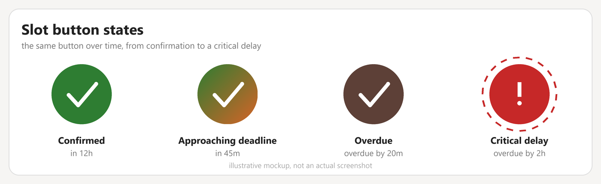
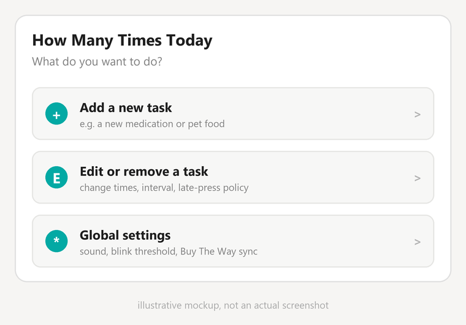

<p align="center">
  
</p>

<p align="center">
  <a href="README.md"><b>English</b></a> ·
  <a href="README.pl.md">Polski</a>
</p>

# How Many Times Today

A Home Assistant custom integration + Lovelace card for tracking things that
need to happen a certain number of times per day (medication, pet feeding,
drinking water, anything recurring).

## Status

Core integration, Lovelace card and translations are implemented and verified
against a live Home Assistant instance. Still open: HACS/hassfest validation
and a visual options editor. See [CHANGELOG.md](CHANGELOG.md) for details.

## Concept

Each defined task (e.g. "pill, twice a day at 9:00 and 22:00") expands into
independent **slots** — one button per expected occurrence per day.

The button's color fades over time (green → red → brown) as the expected time
approaches and passes, and starts blinking in extreme cases (forgotten /
significantly overdue). Pressing it resets the slot and logs an entry in its
history.

Full functional specification: [docs/SPECIFICATION.md](docs/SPECIFICATION.md)
([Polish version](docs/SPECYFIKACJA.md))

<p align="center">
  
</p>
<p align="center">
  
</p>

> These are illustrative mockups built from the actual card/color code, not
> real screenshots — there is no browser automation in this environment to
> capture a live Home Assistant UI yet.

<p align="center">
  
</p>

> This one above **is** a real screenshot — the local Docker test instance
> (see [docs/TESTING.md](docs/TESTING.md)), authenticated, in Polish, in dark
> mode. A real screenshot of the card itself is still pending: this HA
> version's client-side router didn't cooperate with headless automation for
> custom dashboard routes (see TESTING.md) — the card's behavior is instead
> verified through the API-driven test sequence documented there.

## Documentation & issue tracking

- Confluence: `HMTT` space on jacekbieganowski.atlassian.net
- Jira: `HMTT` project

## Installation

Eventually via [HACS](https://hacs.xyz/) as a custom repository (not ready for
use yet). The Lovelace card is bundled inside the integration and registers
itself automatically — no manual Resource step required.

Adding a slot to a dashboard (one card per slot sensor):

```yaml
type: custom:how-many-times-today-card
entity: sensor.cat_food_1_status
```

## Development

Unit tests cover the pure scheduling logic (`custom_components/how_many_times_today/models.py`)
without needing a real Home Assistant install:

```sh
pip install -r requirements-test.txt
python -m pytest tests/
```

Runs automatically on every push via GitHub Actions.

## License

MIT — see [LICENSE](LICENSE).
