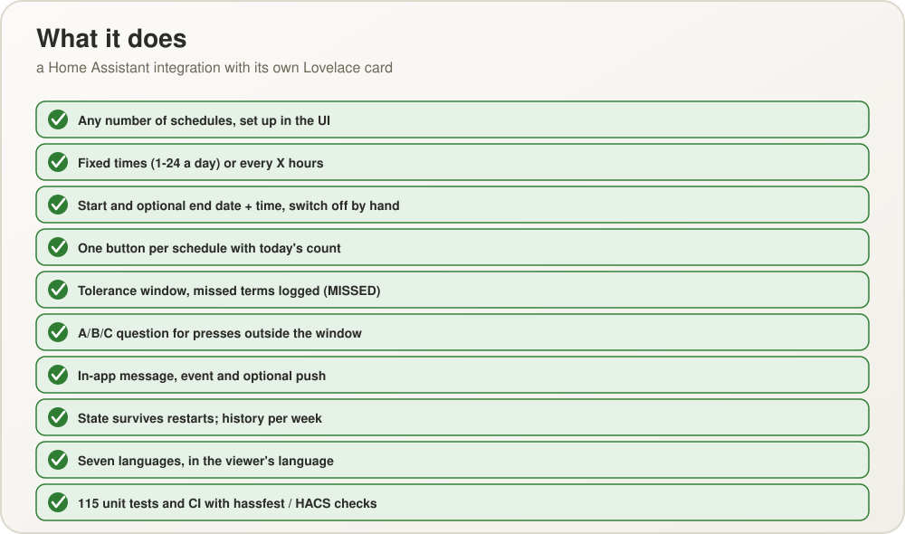

<p align="center">
  
</p>

<p align="center">
  <a href="README.md"><b>English</b></a> ·
  <a href="README.pl.md">Polski</a>
</p>

# How Many Times Today

A Home Assistant custom integration with its own Lovelace card for things that must
happen a certain number of times a day: medication, pet feeding, drinking water, anything
recurring. Each thing is a **schedule** with one button, one sensor and a counter of
today's executions.

<p align="center">
  
</p>

## How it works

A schedule is either **fixed times** (1–24 a day, for example 07:00 and 16:00) or **every X
hours**, and has a start, an optional end and a tolerance window (default 30 minutes before
and after each term). The button carries a big number — how many times it was done today
— and its colour follows the day: green after an execution, fading to red as the next term
approaches, red when it is due, blinking brown when it was not done in time. A term nobody
closed is logged as missed.

Pressing outside the window while a term is still open asks what happened (it was done but
not recorded, it was not done and is done now, or it was done and this is an additional
one). A press that matches no term is logged "outside the schedule" and the number blinks;
more executions than planned turn the button red with a black number.

<p align="center">
  
</p>

> A real screenshot: the card on a dashboard of the local Docker test instance
> (see [docs/TESTING.md](docs/TESTING.md)).

<p align="center">
  
</p>

<p align="center">
  
</p>

The full functional specification: [docs/SPECIFICATION.md](docs/SPECIFICATION.md)
([Polish version](docs/SPECYFIKACJA.md)).

## Installation

Copy the `custom_components/how_many_times_today` folder into the `custom_components/`
directory of your Home Assistant configuration and restart Home Assistant. The Lovelace
card is bundled inside the integration and registers itself automatically — no manual
Resource step required.

Then add the integration under **Settings → Devices & services → Add integration**.

## Configuration

Everything is configured in the UI (the gear icon of the integration): schedules, the
sound and an optional push notification service. Step-by-step guide with screenshots:
[docs/CONFIGURATION.md](docs/CONFIGURATION.md) (Polish:
[docs/CONFIGURATION.pl.md](docs/CONFIGURATION.pl.md)).

Adding a schedule to a dashboard (one card per schedule sensor):

```yaml
type: custom:how-many-times-today-card
entity: sensor.heart_medication
```

Or add it through the dashboard UI's "Add card" picker — it offers an entity picker
limited to this integration's own sensors.

Services (all take the schedule's sensor as the target): `press_schedule` (with an
optional `answer`), `clear_history`, `set_schedule_active`, `reset_schedule` and `update_schedule` (name, times, interval, start, end, window). When a term comes due the
event `how_many_times_today_due` is fired, and an optional push goes to the mobile app.

<p align="center">
  
</p>

## Development

150 unit tests cover the scheduling engine, the stores and the coordinator without needing
a real Home Assistant install (details in [docs/TESTING.md](docs/TESTING.md)):

```sh
pip install -r requirements-test.txt
python -m pytest tests/
```

Runs automatically on every push via GitHub Actions, together with the hassfest and HACS
validation.

<p align="center">
  
</p>

## Version and author

Versions follow semantic versioning, `MAJOR.MINOR.PATCH` (the number lives in
`custom_components/how_many_times_today/manifest.json`; every release is a commit
"Release X.Y.Z: ..." with the git tag `vX.Y.Z` and a section in the changelog). A
feature raises the minor number, a fix the patch number. The version and the author,
Jacek Bieganowski, are shown on the integration's device page (manufacturer and
firmware), in the dialog that adds the integration and at the top of the **Configure**
menu.

## Regenerating the diagrams

The diagrams in `docs/images/diagram-*.svg` (English and Polish) are generated: edit
`tools/make_diagrams.py` (and `tools/make_config_diagrams.py` for the configuration guide)
and run them with `python`. `pwsh tools/export_png.ps1` renders PNG copies to
`docs/images/png/` for tools that do not display SVG reliably.

## License

MIT — see [LICENSE](LICENSE).
