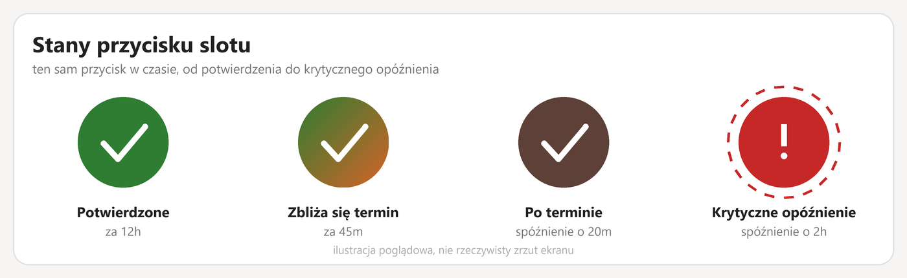
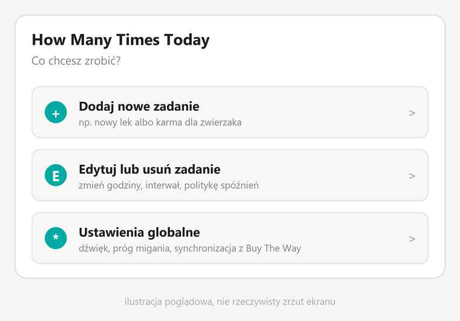
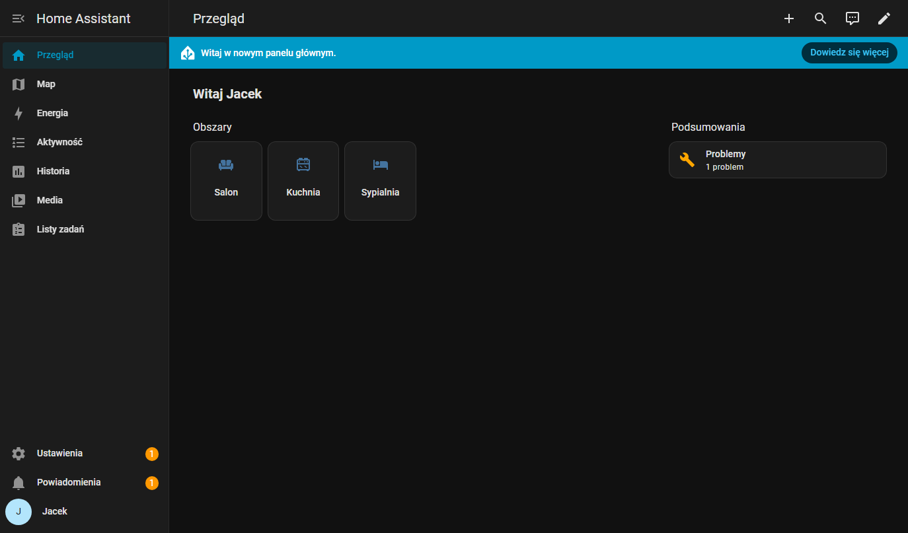

<p align="center">
  
</p>

<p align="center">
  <a href="README.md">English</a> ·
  <a href="README.pl.md"><b>Polski</b></a>
</p>

# How Many Times Today

Integracja Home Assistant + karta Lovelace do śledzenia czynności wykonywanych
cyklicznie w ciągu dnia (leki, karmienie zwierząt, picie wody itp.).

## Status

Silnik integracji, karta Lovelace i tłumaczenia są zaimplementowane i
zweryfikowane na żywej instancji Home Assistant. Zostało jeszcze: walidacja
HACS/hassfest i wizualny edytor opcji. Szczegóły w [CHANGELOG.pl.md](CHANGELOG.pl.md).

## Koncepcja

Każda zdefiniowana czynność (np. "tabletka 2x dziennie o 9:00 i 22:00") tworzy
niezależne **sloty** — osobny przycisk na każde oczekiwane wystąpienie w ciągu
dnia.

Przycisk zmienia kolor w czasie (zielony → czerwony → brązowy) w miarę
zbliżania się i mijania oczekiwanej godziny, a w skrajnym przypadku zaczyna
migać (zapomniano / znaczne spóźnienie). Naciśnięcie resetuje slot i zapisuje
wpis w historii.

Pełna specyfikacja funkcjonalna: [docs/SPECYFIKACJA.md](docs/SPECYFIKACJA.md)
([wersja angielska](docs/SPECIFICATION.md))

<p align="center">
  
</p>
<p align="center">
  
</p>

> To ilustracje poglądowe zbudowane na bazie faktycznego kodu karty/kolorów,
> nie prawdziwe zrzuty ekranu — w tym środowisku nie mam jeszcze automatyzacji
> przeglądarki, żeby przechwycić działający interfejs Home Assistant.

<p align="center">
  
</p>

> Ten powyższy **jest** prawdziwym zrzutem — lokalna testowa instancja w
> Dockerze (zobacz [docs/TESTING.md](docs/TESTING.md)), zalogowana, po polsku,
> w trybie ciemnym. Prawdziwy zrzut samej karty wciąż czeka — router SPA w tej
> wersji HA nie współpracował z automatyzacją dla ścieżek własnych dashboardów
> (szczegóły w TESTING.md) — działanie karty jest zamiast tego zweryfikowane
> sekwencją testów przez API opisaną tam.

## Dokumentacja i śledzenie zadań

- Confluence: przestrzeń `HMTT` na jacekbieganowski.atlassian.net
- Jira: projekt `HMTT`

## Instalacja

Docelowo przez [HACS](https://hacs.xyz/) jako custom repository (status:
jeszcze niegotowe do użycia). Karta Lovelace jest dołączona wewnątrz integracji
i rejestruje się sama — bez ręcznego dodawania zasobu.

Dodanie slotu do pulpitu (jedna karta na jeden sensor slotu):

```yaml
type: custom:how-many-times-today-card
entity: sensor.karma_dla_kota_1_status
```

## Rozwój

Testy jednostkowe pokrywają czystą logikę harmonogramu
(`custom_components/how_many_times_today/models.py`) bez potrzeby realnej
instalacji Home Assistant:

```sh
pip install -r requirements-test.txt
python -m pytest tests/
```

Uruchamiają się automatycznie przy każdym pushu przez GitHub Actions.

## Licencja

MIT — patrz [LICENSE](LICENSE).
