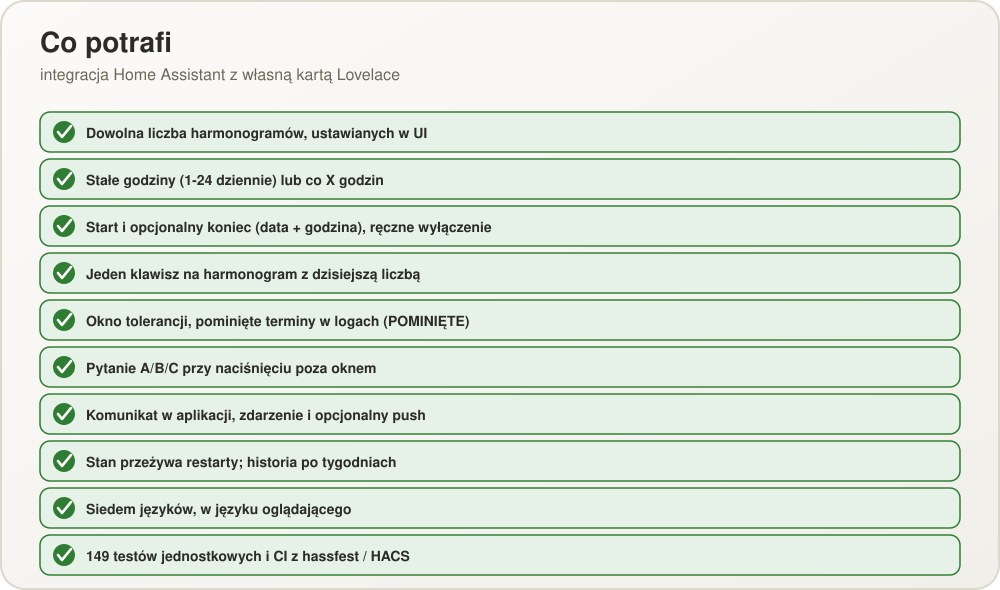

<p align="center">
  
</p>

<p align="center">
  <a href="README.md">English</a> ·
  <a href="README.pl.md"><b>Polski</b></a>
</p>

# How Many Times Today

Integracja Home Assistant z własną kartą Lovelace do rzeczy, które trzeba zrobić określoną
liczbę razy dziennie: leki, karmienie zwierząt, picie wody, cokolwiek cyklicznego. Każda
taka rzecz to **harmonogram** z jednym klawiszem, jednym sensorem i licznikiem
dzisiejszych wykonań.

<p align="center">
  
</p>

## Jak to działa

Harmonogram to **stałe godziny** (1–24 na dobę, np. 07:00 i 16:00) albo **co X godzin**, ma
start, opcjonalny koniec i okno tolerancji (domyślnie 30 minut przed i po każdym terminie).
Klawisz niesie dużą liczbę — ile razy zrobiono to dzisiaj — a jego kolor podąża za dniem:
zielony po wykonaniu, przechodzący w czerwony w miarę zbliżania się terminu, czerwony, gdy
jest należny, i migający na brązowo, gdy nie zrobiono w terminie. Termin, którego nikt nie
zamknął, trafia do logu jako pominięty.

Naciśnięcie poza oknem, gdy termin jest jeszcze otwarty, pyta, co zaszło (było zrobione, ale
nie zapisane; nie zrobiono i robi się teraz; albo zrobiono i to jest dodatkowe). Naciśnięcie
pasujące do żadnego terminu zapisuje się jako „poza harmonogramem”, a liczba miga; więcej
wykonań niż zaplanowano robi klawisz czerwonym z czarną liczbą.

<p align="center">
  
</p>

> Prawdziwy zrzut: karta na dashboardzie lokalnej instancji testowej w Dockerze (zobacz
> [docs/TESTING.pl.md](docs/TESTING.pl.md)).

<p align="center">
  
</p>

<p align="center">
  
</p>

Pełna specyfikacja funkcjonalna: [docs/SPECYFIKACJA.md](docs/SPECYFIKACJA.md)
([wersja angielska](docs/SPECIFICATION.md)).

## Instalacja

Skopiuj folder `custom_components/how_many_times_today` do katalogu `custom_components/` w
konfiguracji Home Assistant i zrestartuj Home Assistant. Karta Lovelace jest dołączona do
integracji i rejestruje się sama — bez ręcznego dodawania zasobu.

Potem dodaj integrację w **Ustawienia → Urządzenia i usługi → Dodaj integrację**.

## Konfiguracja

Wszystko konfiguruje się w UI (ikona koła zębatego integracji): harmonogramy, dźwięk i
opcjonalną usługę powiadomień push. Przewodnik krok po kroku ze zrzutami ekranu:
[docs/CONFIGURATION.pl.md](docs/CONFIGURATION.pl.md) (angielski:
[docs/CONFIGURATION.md](docs/CONFIGURATION.md)).

Dodanie harmonogramu do dashboardu (jedna karta na jeden sensor harmonogramu):

```yaml
type: custom:how-many-times-today-card
entity: sensor.lek_na_serce
```

Albo przez „Dodaj kartę" w UI dashboardu — pojawi się selektor encji ograniczony do
sensorów tej integracji.

Usługi (wszystkie przyjmują sensor harmonogramu jako cel): `press_schedule` (z opcjonalnym
`answer`), `clear_history`, `set_schedule_active` i `update_schedule` (nazwa, godziny, interwał, start, koniec, okno). Gdy termin przypada, odpalane jest
zdarzenie `how_many_times_today_due`, a opcjonalny push idzie do aplikacji mobilnej.

<p align="center">
  
</p>

## Rozwój

139 testów jednostkowych pokrywa silnik harmonogramów, magazyny i koordynator bez potrzeby
realnej instalacji Home Assistant (szczegóły w [docs/TESTING.pl.md](docs/TESTING.pl.md)):

```sh
pip install -r requirements-test.txt
python -m pytest tests/
```

Uruchamiają się automatycznie przy każdym pushu przez GitHub Actions, razem z walidacją
hassfest i HACS.

<p align="center">
  
</p>

## Regenerowanie diagramów

Diagramy w `docs/images/diagram-*.svg` (angielskie i polskie) są generowane: edytuj
`tools/make_diagrams.py` (oraz `tools/make_config_diagrams.py` dla przewodnika
konfiguracji) i uruchom je przez `python`. `pwsh tools/export_png.ps1` renderuje kopie PNG do
`docs/images/png/` dla narzędzi, które niezawodnie nie wyświetlają SVG.

## Licencja

MIT — patrz [LICENSE](LICENSE).
