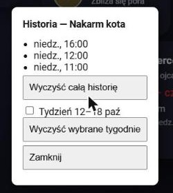

# Configuration guide — How Many Times Today

([Polish version](CONFIGURATION.pl.md))

Everything is set up from the Home Assistant UI — no YAML is needed to create
schedules. This guide covers adding the integration, defining schedules, the global
settings, the entities and services the integration creates, notifications, and how to
put a schedule on a dashboard.

> The screenshots come from a real Home Assistant instance whose interface is set to
> Polish. The English labels are given in the text and tables.

## 1. Install and add the integration

1. Copy the `custom_components/how_many_times_today` folder into the
   `custom_components` folder of your Home Assistant configuration and restart Home
   Assistant.
2. Go to **Settings → Devices & services → Add integration**, search for
   **How Many Times Today**. It is created at once; there is nothing to fill in.

   Or, without the UI: put a bare `how_many_times_today:` line in `configuration.yaml`
   and restart — the integration adds itself once (the line may stay).

The integration is a **singleton**: there is exactly one entry and all schedules live
inside it. Adding it a second time shows "Already configured".

The card (`custom:how-many-times-today-card`) ships inside the integration and
registers itself, so no dashboard resource has to be added by hand: on start the integration
adds it to **Settings → Dashboards → Resources** (and removes it again when the integration
is deleted) and also loads it as an extra module, so it is available on every dashboard.

> **Time zone.** Schedules follow the time zone configured in Home Assistant
> (**Settings → System → General**). "09:00" means 09:00 in that zone, and start/end
> dates are read in it too.

## 2. The Configure dialog

Open **Settings → Devices & services → How Many Times Today** and click the **gear
icon** on the integration entry.


| Menu item | What it does |
| --- | --- |
| **Add a new schedule** | Creates a schedule (medication, feeding, water, …) |
| **Edit, switch on/off or remove a schedule** | Changes a schedule, switches it off or on by hand, or deletes it |
| **Reset to "all on time"** | Sets chosen schedules to the state where everything due so far today was done on time |
| **Global settings (sound, push notification)** | Settings shared by all schedules |
| **How to read the card?** | A help page: what every colour and sentence on the button means |


Every step saves immediately and takes effect without restarting Home Assistant.

## 3. Adding a schedule

Choose **Add a new schedule**. You can create as many schedules as you need.


| Field | Meaning |
| --- | --- |
| **Name** | Free text, e.g. *Heart medication*. It is the entity's name |
| **Description** | Shown under the button, in the notification and above the history. Optional |
| **Schedule mode** | **Fixed times of day** or **Every X hours** |

### Fixed times of day

First a counter asks **how many times a day** (1–24, with up and down arrows); then one
time field appears for each execution.


The times need not be evenly spaced (for example 07:00 and 16:00). The number of times
is the **planned count** per day.

### Every X hours

No list of times: only the interval.


| Field | Meaning | Range / default |
| --- | --- | --- |
| **Interval (hours)** | Time between two terms | 0.5 – 48 h in steps of 0.5; default 12 |

The **first term is exactly the start** you set in the next step; every following term
comes one interval after the previous one, across midnight. The planned count per day
is `24 ÷ interval`, rounded up (12 h → 2, 8 h → 3, 5 h → 5).


### Start, end and tolerance


| Field | Meaning | Default |
| --- | --- | --- |
| **Start (date and time)** | When the schedule begins; before it the button shows `pending` | the moment the form was opened |
| **End (date and time, optional)** | When it stops; afterwards the schedule is `inactive`. Must be later than the start | none |
| **Tolerance window (minutes before and after)** | A press this close to a term counts as on schedule | 30 (1 – 240) |

If you create a schedule a few minutes after its start, the first term is shown as due
right away; terms older than the tolerance window are not backfilled.

## 4. How a press is judged

A **term** is a moment a schedule is due. Each term has a tolerance window (default
30 minutes before and after).


- **Inside the window** — the press is on schedule: the term is closed and a normal
  history entry is written. Pressing a little *before* the term (inside the window)
  closes it in advance, so the button never turns red for it.
- **Outside the window, a term is open** — Home Assistant asks which of three things
  happened, about the **oldest open term**. The card shows the question; automations
  pass the answer in the `answer` field.
- **Outside the window, nothing open** — it is an extra execution, logged as
  **OUTSIDE THE SCHEDULE**; the number on the button blinks.

| Answer | Meaning | Today's count | History |
| --- | --- | --- | --- |
| `already_done` (A) | It was done at that time, it just was not recorded | +1 | registered late |
| `do_now` (B) | It was not done then — doing it now | +1 | outside the schedule |
| `extra` (C) | It was done then, and this is an additional one | +2 | registered late + outside the schedule |


Several open terms are closed one per press, oldest first. A second press inside the
window of an already closed term is an extra execution.

## 5. Editing, switching on/off and removing

Choose **Edit, switch on/off or remove a schedule**, pick the schedule and the action.


- **Edit this schedule** opens the same steps as when adding. Progress and history are
  kept; a mode change is allowed.
- **Switch on / off** toggles the schedule by hand (the card editor has the same
  **Schedule active** checkbox). A switched-off schedule has the state `inactive`, sends no
  alerts and logs no missed terms; the time spent off is not backfilled when it is
  switched on again. Its card is hidden on the dashboard and shows grey only while the
  dashboard is being edited, so it can still be selected and switched back on. The history
  stays available.
- **Remove this schedule and its entity** deletes it with its history.

If there is no schedule yet, the menu item shows "No schedules defined yet".

### Reset to "all on time"

Choose **Reset to "all on time"** when the real life and the button have drifted apart —
for example it is 2 pm, the cat was in fact fed at 7 as scheduled, but nobody pressed the
button. Tick the schedules (all are ticked by default) and confirm:

- every term of today that has already come due (and any term still open from earlier)
  is closed as done on time, so the button lights up as it should and nothing is blinking
  or red;
- today's counter becomes the number of terms already due (1 of 3 at 2 pm for a cat fed
  at 7, 13 and 20), and today's history gets one normal entry per such term, stamped with
  the term's own time (07:00 in the example). Entries made earlier today for these
  schedules are replaced; earlier days stay as they are;
- schedules that are switched off or have not started yet are skipped.

This also undoes pointless presses: if the button was pressed by mistake (the counter shows
4 of 2 and the state is `exceeded`), the reset brings the counter back to the terms already
due and removes the surplus entries from today's history.

The same is available as the `reset_schedule` service (section 9).

## 6. Global settings

Choose **Global settings (sound, push notification)**.


| Field | Meaning |
| --- | --- |
| **Notification sound** | One sound for the whole plugin: `chime`, `bell`, `alert`, `gentle` or `none` (default `chime`). It plays in the browser showing the card when a schedule turns `red`, and again when it turns `blinking_brown` |
| **Push notification service** | Optional, e.g. `notify.mobile_app_phone`. The dropdown lists the mobile-app notifiers; any notify service can be typed. Empty means no push |

### How to read the card

The fourth menu item, **How to read the card?**, is a help page. It explains in plain
words what every colour and every sentence under the name means, what the big number is,
and what to do when the button blinks. Its wording is exactly what the card shows, in the
language of the logged-in user. Confirming it returns to the menu; nothing is changed.


## 7. What the integration creates

One **device**, "How Many Times Today", groups all the sensors. Its page (Settings → Devices & services → Devices) shows the **manufacturer** (the author, Jacek Bieganowski) and the **firmware** (the integration's version). The same version and author appear at the top of the Configure menu.

One **sensor per schedule**, named after the schedule (for example
`sensor.heart_medication`). Its state is the look of the button:

| State | Meaning |
| --- | --- |
| `pending` | Before the start date and time |
| `green` | Just confirmed (or nothing due yet) |
| `transition` | The colour fades from green to red towards the next term |
| `red` | A term is due and inside its window |
| `blinking_brown` | A term outlived its window and is still open; it keeps blinking |
| `exceeded` | More executions today than planned (red button, black number) |
| `inactive` | Switched off by hand, or past the end |

When several apply, the first match in this order wins: `inactive`, `pending`,
`blinking_brown`, `exceeded`, `red`, `transition`, `green`.


The card never relies on colour alone: under the name it shows a short, plain sentence
for the state.

| State | Sentence on the card |
| --- | --- |
| `pending` | Not started yet |
| `green` | Done — all good |
| `transition` | Getting close |
| `red` | NOW — time to do it |
| `blinking_brown` | WARNING — overdue! |
| `exceeded` | Done too many times |
| `inactive` | Switched off |

Attributes:

| Attribute | Meaning |
| --- | --- |
| `schedule_id`, `name`, `description` | Identity and the description |
| `mode`, `times` / `interval_hours` | Fixed times (`times`, list of `HH:MM`) or the interval |
| `start_at`, `end_at`, `window_minutes` | The range and the tolerance window |
| `active`, `manually_inactive` | Whether it takes presses; whether it was switched off by hand |
| `count_today`, `planned_count`, `count_exceeded` | The big number, the plan, and whether it is exceeded |
| `number_blinking` | The number blinks after an out-of-window execution within the plan; the next press stops it |
| `answer_required` | `true` when a press needs the A/B/C answer right now |
| `open_slots` | Unresolved terms, oldest first: `scheduled_at`, `overdue_minutes`, `missed` |
| `color_progress` | 0.0 – 1.0 progress of the fade; `null` outside `green` and `transition` |
| `last_pressed_at`, `next_expected_at`, `seconds_to_next_expected` | The last press and the next term |
| `history` | The newest 50 entries (see below) |
| `sound` | The global sound |

History entries are an event type plus data — never ready-made text — so the card shows
them in the viewer's language: `timestamp`, `kind` (`on_schedule`, `registered_late`,
`outside`, `extra`, `missed`), `scheduled_at` (the closed term, or `null`),
`outside_schedule` (bool) and `count_delta` (what it added to the count).

Today's count is the sum of today's `count_delta` values, so it resets at midnight. The
state is stored separately from the history and survives Home Assistant restarts; a term
that came due while Home Assistant was down is still open afterwards.

## 8. A schedule on a dashboard

Add one card per schedule. In the UI use **Add card → How Many Times Today** — a visual
editor offers an entity picker limited to this integration's sensors. The card's editor chooses **which schedule the card shows** and lets you change that
schedule right there: its name and description, the times (how many a day and each
time) or the interval, and — under **Advanced** — the start, the end (with a button to
remove it) and the tolerance window. **Save schedule changes** applies them at once, the
preview updates, and a message under the button says "Saved" or why the change was
refused. Progress and history are kept. Only the kind of schedule (fixed times / every
X hours) is changed in the integration settings (section 5), which the editor links to.
The **Appearance** field switches the card between **Card (large)**, the default, and
**Tile (compact)**. Each card chooses on its own, so large cards and tiles can sit side by
side, and the same schedule can have both.

```yaml
type: custom:how-many-times-today-card
entity: sensor.heart_medication
layout: tile      # card (default) or tile
```


On a tile, a **tap** presses the button (with the same question when one is needed), and
a **long press**, a right click or Shift+Enter opens the history with the options to
clear it:



Or in YAML:

```yaml
type: custom:how-many-times-today-card
entity: sensor.heart_medication
```


"Show history" expands the entries; those outside the schedule carry the bold prefix
and can be cleared entirely or by week:


Weeks are listed as date ranges in the viewer's language ("Week 12–18 Oct"), not as week numbers.

## 9. Services

All five are entity services: pick the schedule's sensor as the target.

| Service | Fields | Effect |
| --- | --- | --- |
| `how_many_times_today.press_schedule` | `answer` (optional) | Confirms the schedule, like pressing its button |
| `how_many_times_today.clear_history` | `weeks` (optional) | Clears the press history |
| `how_many_times_today.set_schedule_active` | `active` (required) | Switches the schedule on or off |
| `how_many_times_today.reset_schedule` | — | Sets the schedule to "everything due so far today was done on time" (counter and today's history; earlier days stay) |
| `how_many_times_today.update_schedule` | `name`, `description`, `fixed_times`, `interval_hours`, `start_at`, `end_at`, `window_minutes` (all optional, at least one) | Changes the schedule's name, description, times or interval, start, end or tolerance window (the card editor uses it) |

```yaml
action: how_many_times_today.press_schedule
target:
  entity_id: sensor.heart_medication
data:
  answer: do_now
```

`update_schedule` changes only the fields you give; the mode (fixed times / every X hours) stays as it is, so `fixed_times` fits only a fixed-times schedule and `interval_hours` only an every-X-hours one. An empty `end_at` removes the end. A change that cannot work (a malformed time, more than 24 times, an interval outside 0.5–48 hours, a window outside 1–240 minutes, an end before the start, nothing to change) fails with a validation error carrying a translated message; the schedule's progress and history are kept:

```yaml
action: how_many_times_today.update_schedule
target:
  entity_id: sensor.heart_medication
data:
  name: Heart medication
  fixed_times: ["07:30", "19:30"]
```

`press_schedule` without an `answer` when one is needed fails with a validation error
whose translation key is `answer_required` (`schedule_not_active` for a pending or
inactive schedule). `clear_history` without `weeks` clears everything; with `weeks`
(ISO weeks such as `2026-W41`) only those weeks:

```yaml
action: how_many_times_today.clear_history
target:
  entity_id: all
data:
  weeks:
    - 2026-W41
```

## 10. Notifications


At the moment a term comes due the sensor turns `red`, once, on the exact second, and:

- the card shows an **in-app message** with the description (only while a Home Assistant
  panel is open) and plays the sound. It reacts to the sensor turning `red`, which every
  Home Assistant user receives; subscribing to a custom event over the WebSocket needs an
  administrator, which is why the card does not rely on the event;
- the event **`how_many_times_today_due`** is fired for automations, with
  `entity_id`, `name`, `description` and `scheduled_at`;
- if a **push notification service** is set, a push with the description goes through the
  Home Assistant Companion app, which works with the app closed.

Nothing repeats at `blinking_brown` or when a term is logged as missed.

## 11. Automation examples

Notify when a term comes due, using the event:

```yaml
alias: Schedule due
triggers:
  - trigger: event
    event_type: how_many_times_today_due
actions:
  - action: notify.notify
    data:
      title: "{{ trigger.event.data.name }}"
      message: "{{ trigger.event.data.description }}"
```

Confirm a schedule from a physical button:

```yaml
alias: Confirm heart medication
triggers:
  - trigger: state
    entity_id: binary_sensor.pill_box_opened
    to: "on"
actions:
  - condition: state
    entity_id: sensor.heart_medication
    attribute: answer_required
    state: false
  - action: how_many_times_today.press_schedule
    target:
      entity_id: sensor.heart_medication
```

## 12. Troubleshooting

| Symptom | Cause and fix |
| --- | --- |
| The card shows "Configuration error" | The card's JavaScript is not loaded — typically a cached copy. Reload the page; if it persists, unregister the service worker and clear the browser cache (see [TESTING.md](TESTING.md)) |
| "Already configured" when adding the integration | It is a singleton — use the gear icon on the existing entry |
| "No schedules defined yet" in the edit menu | Add a schedule first |
| A schedule is `blinking_brown` right after a restart | Intended: the stored state is restored, so a term missed during the downtime stays visible |
| The button is grey and says it has not started | Before the start; presses are refused until then |
| A schedule's card has disappeared from the dashboard | It is switched off or past its end (`inactive`); edit the dashboard to see it grey, then tick **Schedule active** in its editor or switch it on in the Configure dialog |
| Times look two hours off | Schedules use the time zone configured in Home Assistant, not the browser's |

How the pieces fit together: [SPECIFICATION.md](SPECIFICATION.md).
