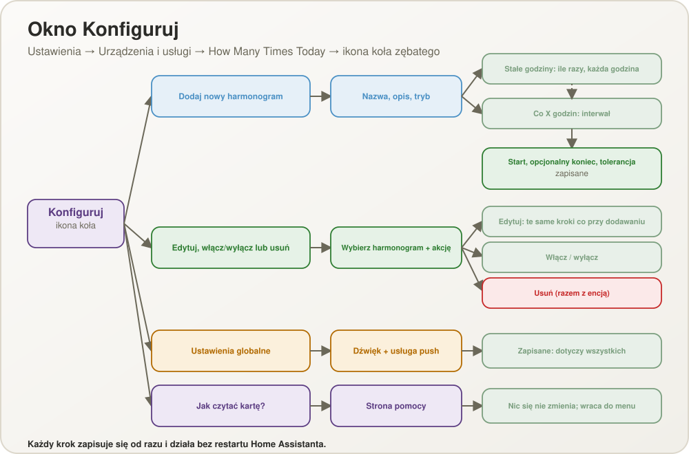
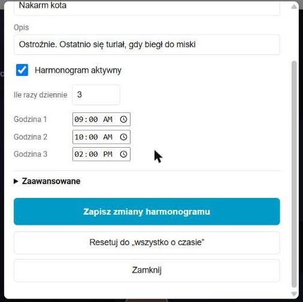

# Przewodnik konfiguracji — How Many Times Today

([English version](CONFIGURATION.md))

Całość konfiguruje się z poziomu interfejsu Home Assistant — do tworzenia harmonogramów
nie trzeba edytować YAML. Ten przewodnik opisuje dodanie integracji, definiowanie
harmonogramów, ustawienia globalne, encje i usługi tworzone przez integrację,
powiadomienia oraz umieszczenie harmonogramu na dashboardzie.

> Zrzuty ekranu pochodzą z prawdziwej instancji Home Assistant z interfejsem po polsku.
> Etykiety w tekście i tabelach odpowiadają tym na zrzutach.

## 1. Instalacja i dodanie integracji

1. Skopiuj folder `custom_components/how_many_times_today` do folderu
   `custom_components` w konfiguracji Home Assistant i zrestartuj Home Assistant.
2. Wejdź w **Ustawienia → Urządzenia i usługi → Dodaj integrację**, wyszukaj
   **How Many Times Today**. Powstaje od razu; nie ma nic do wypełnienia.

   Albo bez interfejsu: wpisz samą linię `how_many_times_today:` w `configuration.yaml` i
   zrestartuj — integracja doda się sama (raz; linia może zostać).

Integracja jest **pojedyncza**: istnieje dokładnie jeden wpis, a wszystkie harmonogramy
są w jego wnętrzu. Dodanie jej drugi raz pokazuje „Już skonfigurowano”.

Karta (`custom:how-many-times-today-card`) jest dołączona do integracji i rejestruje się
sama, więc nie trzeba ręcznie dodawać zasobu do dashboardu: przy starcie integracja dodaje
ją do **Ustawienia → Pulpity → Zasoby** (i usuwa, gdy integrację skasujesz) oraz ładuje jako
dodatkowy moduł, więc jest dostępna na każdym pulpicie. Adres zawiera wersję integracji, więc każda aktualizacja zmusza aplikacje i przeglądarki do ponownego pobrania karty.

> **Strefa czasowa.** Harmonogramy podążają za strefą czasową skonfigurowaną w Home
> Assistant (**Ustawienia → System → Ogólne**). „09:00” oznacza 09:00 w tej strefie, a
> daty startu i końca też są w niej odczytywane.

## 2. Okno Konfiguruj

Otwórz **Ustawienia → Urządzenia i usługi → How Many Times Today** i kliknij **ikonę
koła zębatego** przy wpisie integracji.


| Pozycja menu | Do czego służy |
| --- | --- |
| **Dodaj nowy harmonogram** | Tworzy harmonogram (lek, karmienie, woda, …) |
| **Edytuj, włącz/wyłącz lub usuń harmonogram** | Zmienia harmonogram, wyłącza go lub włącza ręcznie albo usuwa |
| **Reset do „wszystko na czas”** | Ustawia wybrane harmonogramy w stan, w którym wszystko, co do tej pory dziś przypadało, zrobiono na czas |
| **Ustawienia globalne (dźwięk, powiadomienie push)** | Ustawienia wspólne dla wszystkich harmonogramów |
| **Jak czytać kartę?** | Strona pomocy: co znaczy każdy kolor i każde zdanie na klawiszu |



Każdy krok zapisuje się od razu i działa bez restartu Home Assistanta.

## 3. Dodawanie harmonogramu

Wybierz **Dodaj nowy harmonogram**. Możesz utworzyć dowolnie wiele harmonogramów.


| Pole | Znaczenie |
| --- | --- |
| **Nazwa** | Dowolny tekst, np. *Lek na serce*. To nazwa encji |
| **Opis** | Pokazywany pod klawiszem, w powiadomieniu i nad historią. Opcjonalny |
| **Tryb harmonogramu** | **Stałe godziny w ciągu dnia** albo **Co X godzin** |

### Stałe godziny w ciągu dnia

Najpierw licznik pyta, **ile razy dziennie** (1–24, ze strzałkami góra/dół); potem dla
każdego wykonania pojawia się osobne pole z godziną.


Godziny nie muszą być równo rozłożone (np. 07:00 i 16:00). Liczba godzin to
**planowana liczba** wykonań na dobę.

### Co X godzin

Bez listy godzin: tylko interwał.


| Pole | Znaczenie | Zakres / domyślnie |
| --- | --- | --- |
| **Interwał (godziny)** | Czas między dwoma terminami | 0,5 – 48 h co 0,5; domyślnie 12 |

**Pierwszy termin to dokładnie start** ustawiony w następnym kroku; każdy kolejny
przypada o jeden interwał po poprzednim, także po północy. Planowana liczba na dobę to
`24 ÷ interwał` zaokrąglone w górę (12 h → 2, 8 h → 3, 5 h → 5).


### Start, koniec i tolerancja


| Pole | Znaczenie | Domyślnie |
| --- | --- | --- |
| **Start (data i godzina)** | Kiedy harmonogram się zaczyna; wcześniej klawisz pokazuje `pending` | moment otwarcia formularza |
| **Koniec (data i godzina, opcjonalnie)** | Kiedy się kończy; potem harmonogram jest `inactive`. Musi być późniejszy niż start | brak |
| **Okno tolerancji (minuty przed i po)** | Naciśnięcie tak blisko terminu liczy się jako zgodne z harmonogramem | 30 (1 – 240) |
| **Dźwięk przypomnienia** i **Głośność przypomnienia** (opcjonalne) | Własny dźwięk i głośność tego harmonogramu; *Domyślny* używa globalnych (sekcja 6) | Domyślny |

Jeśli utworzysz harmonogram kilka minut po jego starcie, pierwszy termin od razu
pokazuje się jako należny; terminy starsze niż okno tolerancji nie są nadrabiane.

## 4. Jak oceniane jest naciśnięcie

**Termin** to moment, w którym harmonogram jest należny. Każdy termin ma okno tolerancji
(domyślnie 30 minut przed i po).


- **W oknie** — naciśnięcie jest zgodne z harmonogramem: termin zostaje zamknięty i
  powstaje zwykły wpis w historii. Naciśnięcie chwilę *przed* terminem (w oknie) zamyka
  go z góry, więc klawisz nigdy nie robi się dla niego czerwony.
- **Poza oknem, termin otwarty** — Home Assistant pyta, który z trzech przypadków
  zaszedł, o **najstarszy otwarty termin**. Pytanie pokazuje karta; automatyzacje
  przekazują odpowiedź w polu `answer`.
- **Między dwoma terminami (nic otwartego, okno nadchodzącego terminu jeszcze się nie
  zaczęło)** — w dowolnej odległości od terminu karta pyta, czy to jest **nadchodzące
  wystąpienie, tylko wykonane teraz**, czy dodatkowe. `done_early` zamyka nadchodzący termin
  (+1): klawisz idzie dalej od zielonego, nigdy nie robi się dla tego terminu czerwony, a
  pokazywane następne karmienie to to po nim. `extra` to dodatkowe wykonanie poza
  harmonogramem (+1), a nadchodzący termin pozostaje należny. Jeśli nadchodzący termin jest
  dalej niż jedna czwarta odstępu od poprzedniego terminu, odpowiedź `done_early` wymaga
  drugiego potwierdzenia (karta podaje godzinę terminu i mówi, że zostanie przeskoczony);
  atrybut sensora to `early_far`. Jeśli nadchodzący termin jest już zamknięty, pytania nie
  ma: naciśnięcie jest dodatkowe. Sensor pokazuje
  `early_by_seconds`, gdy naciśnięcie zadałoby pytanie; naciśnięcie bez odpowiedzi kończy
  się błędem `early_answer_required`.
- **Poza oknem, nic otwartego** — to dodatkowe wykonanie, zapisane jako **POZA
  HARMONOGRAMEM**; liczba na klawiszu miga.

| Odpowiedź | Znaczenie | Dzisiejszy licznik | Historia |
| --- | --- | --- | --- |
| `already_done` (A) | Zrobione w tym terminie, tylko nie zapisane | +1 | zarejestrowane z opóźnieniem |
| `do_now` (B) | Nie zrobiono wtedy — robię teraz | +1 | poza harmonogramem |
| `extra` (C) | Zrobione wtedy, a to jest dodatkowe wykonanie | +2 | zarejestrowane z opóźnieniem + poza harmonogramem |
| `done_early` | (pytanie o zbyt wczesne naciśnięcie) Zrobione przed czasem | +1 | zgodnie z harmonogramem, zamyka nadchodzący termin |


Kilka otwartych terminów zamyka się po jednym na naciśnięcie, od najstarszego. Drugie
naciśnięcie w oknie już zamkniętego terminu to dodatkowe wykonanie.

## 5. Edycja, włączanie/wyłączanie i usuwanie

Wybierz **Edytuj, włącz/wyłącz lub usuń harmonogram**, wskaż harmonogram i akcję.


- **Edytuj ten harmonogram** otwiera te same kroki co przy dodawaniu. Postęp i historia
  zostają; zmiana trybu jest dozwolona.
- **Włącz / wyłącz** przełącza harmonogram ręcznie (edytor karty ma to samo pole
  **Harmonogram aktywny**). Wyłączony harmonogram ma stan `inactive`, nie wysyła alertów i
  nie zapisuje pominięć; czas spędzony w wyłączeniu nie jest nadrabiany po ponownym
  włączeniu. Jego karta jest ukryta na pulpicie i szara tylko podczas edycji pulpitu, więc
  można ją nadal zaznaczyć i włączyć z powrotem. Historia pozostaje dostępna.
- **Usuń ten harmonogram i jego encję** usuwa go razem z historią.

Gdy nie ma jeszcze żadnego harmonogramu, pozycja pokazuje „Nie zdefiniowano jeszcze
żadnych harmonogramów”.

### Reset do „wszystko na czas”

Wybierz **Reset do „wszystko na czas”**, gdy życie i klawisz rozjechały się — na przykład
jest 14:00, kota faktycznie nakarmiono o 7:00 zgodnie z harmonogramem, ale nikt nie
nacisnął klawisza. Zaznacz harmonogramy (domyślnie wszystkie) i potwierdź:

- każdy dzisiejszy termin, który już przypadł (oraz każdy wciąż otwarty termin z
  wcześniejszych dni), zostaje zamknięty jako zrobiony na czas, więc klawisz świeci jak
  należy i nic nie miga ani nie jest czerwone;
- dzisiejszy licznik staje się liczbą terminów, które już przypadły (o 14:00 dla kota
  karmionego o 7, 13 i 20 jest to 1 z 3), a dzisiejsza historia dostaje jeden zwykły wpis
  na taki termin, z godziną samego terminu (w przykładzie 07:00). Wcześniejsze dzisiejsze
  wpisy tych harmonogramów są zastępowane; wcześniejsze dni zostają bez zmian;
- harmonogramy wyłączone lub jeszcze niezaczęte są pomijane.

To także cofa niepotrzebne naciśnięcia: jeśli klawisz wciśnięto przez pomyłkę (licznik
pokazuje 4 z 2, a stan to `exceeded`), reset sprowadza licznik z powrotem do terminów, które
już przypadły, i usuwa nadmiarowe wpisy z dzisiejszej historii.

To samo jest dostępne jako usługa `reset_schedule` (sekcja 9).

## 6. Ustawienia globalne

Wybierz **Ustawienia globalne (dźwięk, powiadomienie push)**.


| Pole | Znaczenie |
| --- | --- |
| **Domyślny dźwięk przypomnienia** | Jeden z 18 dźwięków w sześciu klasach: delikatne (`delikatny_dzwonek`, `pozytywka`, `harfa`), średnie (`dzwonek`, `gitara`, `marimba`), mocne (`sygnal`, `fanfara`, `budzik`, `sos` — alfabet Morse'a), bardzo mocne (`alarm`, `syrena`), melodie (`wlaz_kotek`, `kreskowka`, `pop_weasel`) i okolicznościowe (`boze_narodzenie`, `wielkanoc_kurczaczek`, `wielkanoc_dzwony`). Domyślnie `dzwonek`. Gra w przeglądarce pokazującej kartę, gdy harmonogram robi się `red`, i ponownie, gdy robi się `blinking_black`. Pliki serwuje integracja (`/how_many_times_today_files/sounds/<id>_<1-4>.ogg`) |
| **Domyślna głośność** | Wyłącz dźwięk, cicho, średnio, głośno (domyślnie) lub bardzo głośno: cztery poziomy to cztery nagrania każdego dźwięku, więc głośność nie zależy od miksera przeglądarki. Względna wobec głośności urządzenia |
| **Rozmiar tekstu na kartach** | 85 %, 100 % (domyślnie), 115 %, 130 %, 150 % lub 175 % — jak w aplikacji |
| **Wysoki kontrast** | Biały pogrubiony tekst na czarnym na każdej karcie |
| **Usługa powiadomień push** | Opcjonalna, np. `notify.mobile_app_telefon`. Lista podpowiada powiadamiacze aplikacji mobilnej; można wpisać dowolną usługę notify. Puste oznacza brak pusha |

Każdy harmonogram może mieć **własny** dźwięk i głośność: w kroku *Start, koniec i
tolerancja* harmonogramu (oraz w oknie edycji na karcie, z przyciskiem *Odtwórz* do
odsłuchu) wybierz *Domyślny* albo dźwięk i głośność. Opcje zapisane przez wersję 1.x są
czytane tak jak były: `chime` i `bell` stają się `dzwonek`, `alert` — `alarm`, `gentle` —
`delikatny_dzwonek`, a `none` — dźwiękiem domyślnym ze wyłączonym dźwiękiem.

### Jak czytać kartę

Czwarta pozycja menu, **Jak czytać kartę?**, to strona pomocy. Prostymi słowami wyjaśnia,
co znaczy każdy kolor i każde zdanie pod nazwą, czym jest duża liczba i co robić, gdy
klawisz miga. Jej treść to dokładnie to, co pokazuje karta, w języku zalogowanego
użytkownika. Zatwierdzenie wraca do menu; nic się nie zmienia.

Karta ma też własną **pomoc**: przycisk **?** na karcie lub kafelku otwiera okno z wersją w pasku tytułu, przyciskami **A-** / **A+** do rozmiaru tekstu, przełącznikiem wysokiego kontrastu, spisem treści w ramce z grupami, sekcjami (do czego to służy, jak czytać klawisz, jak potwierdzać, jak dodać i zmienić harmonogram, przypomnienia, historia, twoje dane) oraz autorem i datą kompilacji na dole.


## 7. Co tworzy integracja

Jedno **urządzenie** „How Many Times Today” grupuje wszystkie sensory. Jego strona (Ustawienia → Urządzenia i usługi → Urządzenia) pokazuje **producenta** (autora, Jacek Bieganowski) i **oprogramowanie** (wersję integracji). Ta sama wersja i autor widnieją na górze menu Konfiguruj.

Jeden **sensor na harmonogram**, nazwany od harmonogramu (np. `sensor.lek_na_serce`).
Jego stan to wygląd klawisza:

| Stan | Znaczenie |
| --- | --- |
| `pending` | Przed datą i godziną startu |
| `green` | Świeżo potwierdzone (lub nic jeszcze nie przypadło) |
| `transition` | Kolor przechodzi z zielonego przez żółty w czerwony do następnego terminu (zielony do 35 % drogi, żółty przy 55 %) |
| `red` | Termin przypadł i trwa jego okno |
| `blinking_black` | Termin przekroczył okno i wciąż jest otwarty; miga dalej |
| `exceeded` | Więcej wykonań dziś niż zaplanowano (czerwony klawisz, czarna liczba) |
| `inactive` | Wyłączony ręcznie lub po końcu |

Gdy pasuje kilka, wygrywa pierwszy w tej kolejności: `inactive`, `pending`,
`blinking_black`, `exceeded`, `red`, `transition`, `green`.


Karta nie polega samym kolorem: pod nazwą pokazuje krótkie, proste zdanie o stanie.

| Stan | Zdanie na karcie |
| --- | --- |
| `pending` | Jeszcze się nie zaczęło |
| `green` | Jesteś na bieżąco |
| `transition` | Wszystko zgodnie z planem (dopóki następny termin jest daleko), potem Zbliża się pora (od 55 % drogi) |
| `red` | TERAZ |
| `blinking_black` | UWAGA – spóźnione! |
| `exceeded` | Zrobione za dużo razy |
| `inactive` | Wyłączone |

Atrybuty:

| Atrybut | Znaczenie |
| --- | --- |
| `schedule_id`, `name`, `description` | Tożsamość i opis |
| `mode`, `times` / `interval_hours` | Stałe godziny (`times`, lista `HH:MM`) albo interwał |
| `start_at`, `end_at`, `window_minutes` | Zakres i okno tolerancji |
| `active`, `manually_inactive` | Czy przyjmuje naciśnięcia; czy wyłączono go ręcznie |
| `count_today`, `planned_count`, `count_exceeded` | Duża liczba, plan i czy przekroczony |
| `number_blinking` | Liczba miga po wykonaniu poza oknem w granicach planu; kolejne naciśnięcie to gasi |
| `answer_required` | `true`, gdy naciśnięcie wymaga teraz odpowiedzi A/B/C (pytanie o zbyt wczesne naciśnięcie używa `early_by_seconds`) |
| `open_slots` | Nierozwiązane terminy, od najstarszego: `scheduled_at`, `overdue_minutes`, `missed` |
| `color_progress` | Postęp przejścia 0,0 – 1,0; `null` poza `green` i `transition` |
| `last_pressed_at`, `next_expected_at`, `seconds_to_next_expected` | Ostatnie naciśnięcie i następny termin |
| `history` | Ostatnie 50 wpisów (niżej) |
| `sound`, `volume` | Identyfikator dźwięku przypomnienia i poziom głośności (0 – 4) tego harmonogramu (własny, a jeśli brak — domyślny) |
| `own_sound`, `own_volume`, `default_sound`, `default_volume` | Własny wybór harmonogramu (`null` = domyślny) i ustawienie domyślne integracji |
| `early_by_seconds`, `early_far` | O ile wcześniej byłoby naciśnięcie teraz (wtedy pojawia się pytanie), inaczej `null`; `early_far` to `true`, gdy nadchodzący termin jest dalej niż jedna czwarta odstępu (pojawia się drugie potwierdzenie) |
| `font_scale`, `high_contrast` | Rozmiar tekstu i kontrast z ustawień globalnych |
| `version`, `author`, `build` | Wersja integracji, autor i data kompilacji, pokazywane w pomocy karty |

Wpisy historii to typ zdarzenia plus dane — nigdy gotowy tekst — więc karta pokazuje je w
języku oglądającego: `timestamp`, `kind` (`on_schedule`, `registered_late`, `outside`,
`extra`, `missed`), `scheduled_at` (zamknięty termin lub `null`), `outside_schedule`
(bool) i `count_delta` (ile dodał do licznika).

Dzisiejszy licznik to suma dzisiejszych `count_delta`, więc zeruje się o północy. Stan
jest zapisywany osobno od historii i przeżywa restart Home Assistanta; termin, który
przypadł podczas przestoju, po restarcie nadal jest otwarty.

## 8. Harmonogram na dashboardzie

Dodaj jedną kartę na harmonogram. Przez UI użyj **Dodaj kartę → How Many Times Today** —
edytor wizualny oferuje selektor encji ograniczony do sensorów tej integracji. Edytor karty wybiera, **który harmonogram karta pokazuje**, i pozwala od razu go zmienić:
nazwę i opis, godziny (ile razy dziennie i każdą godzinę) albo interwał, a w sekcji
**Zaawansowane** — start, koniec (z przyciskiem jego usunięcia) i okno tolerancji.
**Zapisz zmiany harmonogramu** stosuje je od razu, podgląd się odświeża, a komunikat pod
przyciskiem mówi „Zapisano” albo dlaczego zmiana została odrzucona. Postęp i historia
zostają. Tylko rodzaj harmonogramu (stałe godziny / co X godzin) zmienia się w ustawieniach
integracji (sekcja 5), do których edytor linkuje. Pole **Wygląd** przełącza kartę między **Karta (duża)**, domyślną, a **Kafelek**, który pokazuje
to, co karta w aplikacji na Androida (koło z liczbą, nazwę, opis, zdanie stanu, odliczanie,
„ostatnio / łącznie” i ołówek) bez historii.
Każda karta wybiera osobno, więc duże karty i kafelki mogą stać obok siebie, a ten sam
harmonogram może mieć oba.

```yaml
type: custom:how-many-times-today-card
entity: sensor.lek_na_serce
layout: tile      # card (domyślnie) albo tile
```


Na kafelku **dotknięcie** naciska klawisz (z tym samym pytaniem, gdy jest potrzebne, po
krótkiej chwili, żeby podwójne dotknięcie nie były dwoma naciśnięciami), **podwójne
dotknięcie** lub podwójne kliknięcie (albo Alt+Enter) otwiera okno edycji harmonogramu, a
**długie przytrzymanie**, prawy klik lub Shift+Enter otwiera historię z opcjami jej
czyszczenia. Okno edycji ma te same pola co edytor karty oraz **Resetuj do „wszystko o
czasie”** (sekcja 5), który oznacza wszystko, co dziś już minęło, jako zrobione o czasie:



Rozmiar tekstu i wysoki kontrast z ustawień globalnych dotyczą każdej karty i kafelka. Przycisk **?** obok ołówka otwiera pomoc.

Historia:


Albo w YAML:

```yaml
type: custom:how-many-times-today-card
entity: sensor.lek_na_serce
```


„pokaż historię” rozwija wpisy; te poza harmonogramem mają pogrubiony przedrostek i można
je wyczyścić w całości lub po tygodniach:


Tygodnie są wypisane jako zakresy dat w języku oglądającego („Tydzień 12–18 paź”), a nie jako numery tygodni.

## 9. Usługi

Wszystkie trzy to usługi encji: jako cel wskaż sensor harmonogramu.

| Usługa | Pola | Działanie |
| --- | --- | --- |
| `how_many_times_today.press_schedule` | `answer` (opcjonalne: `already_done`, `do_now`, `extra`, `done_early`) | Potwierdza harmonogram, jak naciśnięcie jego przycisku |
| `how_many_times_today.clear_history` | `weeks` (opcjonalne) | Czyści historię naciśnięć |
| `how_many_times_today.set_schedule_active` | `active` (wymagane) | Włącza lub wyłącza harmonogram |
| `how_many_times_today.reset_schedule` | — | Ustawia harmonogram w stan „wszystko, co dziś przypadało, zrobiono na czas” (licznik i dzisiejsza historia; wcześniejsze dni zostają) |
| `how_many_times_today.update_schedule` | `name`, `description`, `fixed_times`, `interval_hours`, `start_at`, `end_at`, `window_minutes`, `sound_id`, `volume_level` (wszystkie opcjonalne, co najmniej jedno) | Zmienia nazwę, opis, godziny lub interwał, start, koniec, okno tolerancji, dźwięk albo głośność przypomnienia harmonogramu (`default` wraca do ustawienia domyślnego; używa jej edytor karty) |

```yaml
action: how_many_times_today.press_schedule
target:
  entity_id: sensor.lek_na_serce
data:
  answer: do_now
```

`update_schedule` zmienia tylko podane pola; tryb (stałe godziny / co X godzin) pozostaje, więc `fixed_times` pasuje tylko do harmonogramu ze stałymi godzinami, a `interval_hours` tylko do harmonogramu co X godzin. Puste `end_at` usuwa koniec. Zmiana, która nie może zadziałać (błędna godzina, więcej niż 24 godziny, interwał poza 0,5–48 godz., okno poza 1–240 min, koniec przed startem, brak czego zmienić), kończy się błędem walidacji z przetłumaczonym komunikatem; postęp i historia harmonogramu zostają:

```yaml
action: how_many_times_today.update_schedule
target:
  entity_id: sensor.lek_na_serce
data:
  name: Lek na serce
  fixed_times: ["07:30", "19:30"]
```

`press_schedule` bez `answer`, gdy jest potrzebna, kończy się błędem walidacji z kluczem
tłumaczenia `answer_required` (`early_answer_required` dla pytania o zbyt wczesne naciśnięcie,
`schedule_not_active` dla harmonogramu oczekującego lub nieaktywnego). `clear_history` bez `weeks` czyści wszystko; z `weeks` (tygodnie ISO, np.
`2026-W41`) tylko te tygodnie:

```yaml
action: how_many_times_today.clear_history
target:
  entity_id: all
data:
  weeks:
    - 2026-W41
```

## 10. Powiadomienia


W chwili, gdy termin przypada, sensor robi się `red`, raz, co do sekundy, i:

- karta pokazuje **komunikat w aplikacji** z opisem (tylko gdy otwarty jest panel Home
  Assistanta) i gra dźwięk. Reaguje na przejście sensora w `red`, które dostaje każdy
  użytkownik Home Assistanta; subskrypcja zdarzenia niestandardowego przez WebSocket
  wymaga administratora, dlatego karta nie opiera się na zdarzeniu;
- odpalane jest zdarzenie **`how_many_times_today_due`** dla automatyzacji, z polami
  `entity_id`, `name`, `description` i `scheduled_at`;
- jeśli ustawiono **usługę powiadomień push**, idzie push z opisem przez aplikację Home
  Assistant Companion, co działa przy zamkniętej aplikacji.

Nic się nie powtarza przy `blinking_black` ani gdy termin trafia do logów jako pominięty.

## 11. Przykłady automatyzacji

Powiadomienie, gdy termin przypada, na podstawie zdarzenia:

```yaml
alias: Harmonogram należny
triggers:
  - trigger: event
    event_type: how_many_times_today_due
actions:
  - action: notify.notify
    data:
      title: "{{ trigger.event.data.name }}"
      message: "{{ trigger.event.data.description }}"
```

Potwierdzenie harmonogramu fizycznym przyciskiem:

```yaml
alias: Potwierdź lek na serce
triggers:
  - trigger: state
    entity_id: binary_sensor.pudelko_na_leki_otwarte
    to: "on"
actions:
  - condition: state
    entity_id: sensor.lek_na_serce
    attribute: answer_required
    state: false
  - choose:
      # między dwoma terminami naciśnięcie wymaga odpowiedzi: tu „nadchodzące wystąpienie, wykonane teraz”
      - conditions:
          - condition: template
            value_template: "{{ state_attr('sensor.lek_na_serce', 'early_by_seconds') is not none }}"
        sequence:
          - action: how_many_times_today.press_schedule
            target:
              entity_id: sensor.lek_na_serce
            data:
              answer: done_early
    default:
      - action: how_many_times_today.press_schedule
        target:
          entity_id: sensor.lek_na_serce
```

Od wersji 2.1.0 naciśnięcie między dwoma terminami wymaga odpowiedzi (`early_by_seconds` jest
wtedy ustawione); bez niej kończy się błędem `early_answer_required`.

## 12. Rozwiązywanie problemów

| Objaw | Przyczyna i rozwiązanie |
| --- | --- |
| Karta pokazuje „Błąd konfiguracji” | JavaScript karty nie jest załadowany — zwykle to zbuforowana kopia. Przeładuj stronę; jeśli nie pomaga, wyrejestruj service worker i wyczyść pamięć podręczną przeglądarki (zobacz [TESTING.pl.md](TESTING.pl.md)) |
| „Już skonfigurowano” przy dodawaniu integracji | Integracja jest pojedyncza — użyj ikony koła zębatego przy istniejącym wpisie |
| „Nie zdefiniowano jeszcze żadnych harmonogramów” w menu edycji | Najpierw dodaj harmonogram |
| Harmonogram jest `blinking_black` zaraz po restarcie | Zamierzone: zapisany stan jest odtwarzany, więc termin pominięty w czasie przestoju pozostaje widoczny |
| Klawisz jest szary i mówi, że jeszcze się nie zaczęło | Przed startem; do tego czasu naciśnięcia są odrzucane |
| Karta harmonogramu zniknęła z pulpitu | Jest wyłączony lub po końcu (`inactive`); wejdź w edycję pulpitu, by zobaczyć ją na szaro, i zaznacz **Harmonogram aktywny** w jej edytorze albo włącz go w oknie Konfiguruj |
| Godziny wydają się przesunięte o dwie godziny | Harmonogramy używają strefy czasowej skonfigurowanej w Home Assistant, nie przeglądarki |

Jak elementy ze sobą współpracują: [SPECYFIKACJA.md](SPECYFIKACJA.md).

## 13. Alarm na wygaszaczu

Pulpit używany jako wyświetlacz ścienny zwykle ma wygaszacz (na przykład karta
[WallPanel](https://github.com/j-a-n/lovelace-wallpanel)) pokazujący zegar, pogodę i
kalendarz. **Karta alarmu** dokłada pod nimi to, co jest teraz należne, a po wykonaniu
zabiera:

- **jeden harmonogram należny** (czerwony lub migający na czarno): sam harmonogram — koło z
  liczbą, nazwa, opis i zdanie („TERAZ” / „UWAGA – spóźnione!”);
- **kilka harmonogramów należnych**: tylko logo aplikacji i napis „**N wydarzeń**” w poprawnej
  formie liczby języka zalogowanego użytkownika (po polsku: 1 wydarzenie, 2 wydarzenia,
  5 wydarzeń, 22 wydarzenia; tak samo po rosyjsku i ukraińsku, a po angielsku i niemiecku
  liczba pojedyncza i mnoga);
- **nic nie jest należne**: karta chowa się i nie zajmuje miejsca.

Po potwierdzeniu harmonogramu (na dowolnej karcie, w telefonie, usługą) jego sensor robi się
zielony i alarm sam znika z każdego wygaszacza.

### Krok po kroku

1. Upewnij się, że integracja ma wersję **2.3.0 lub nowszą** (Ustawienia → Urządzenia i usługi →
   How Many Times Today pokazuje wersję). Karta alarmu jest w tym samym pliku co pozostałe
   karty; nie trzeba niczego dodawać jako zasobu.
2. Otwórz pulpit z wygaszaczem, wybierz ołówek (**Edytuj pulpit**), trzy kropki, **Edytor
   surowej konfiguracji**.
3. Znajdź sekcję `wallpanel:` i jej listę `cards:`. Karty wygaszacza są pokazywane jedna pod
   drugą w tej kolejności, więc alarm wstaw **po karcie kalendarza**:

   ```yaml
   wallpanel:
     enabled: true
     cards:
       - type: clock
       - type: weather-forecast
         entity: weather.home
       - type: custom:calendar-card-pro
         entities:
           - entity: calendar.moj_kalendarz
       - type: custom:how-many-times-today-alert-card   # <- alarm, pod kalendarzem
   ```

4. **Zapisz** i zamknij edytor. Odśwież stronę (albo poczekaj, aż wygaszacz uruchomi się
   ponownie): wygaszacz od razu pokazuje nową kartę.
5. Sprawdź: ustaw harmonogram z terminem za minutę (sekcja 5) albo zmień stan testem opisanym
   w [TESTING.pl.md](TESTING.pl.md). Gdy termin przypadnie, alarm pojawia się na wygaszaczu;
   naciśnij klawisz na pulpicie (albo w telefonie), a alarm zniknie.
6. Powtórz kroki 2–4 dla **każdego pulpitu, którego wygaszacz ma pokazywać alarm** (każdy
   pulpit ma własną sekcję `wallpanel:`).

### Opcje

| Opcja | Znaczenie |
| --- | --- |
| `entities` | Opcjonalna lista sensorów harmonogramów, które karta obserwuje. Bez niej obserwowane są wszystkie harmonogramy integracji |

```yaml
- type: custom:how-many-times-today-alert-card
  entities:
    - sensor.karmienie_kota
    - sensor.karmienie_krolika
```

Karta jest tylko wyświetlaczem: dotknięcie budzi wygaszacz, to nie jest przycisk. Rozmiar
tekstu i wysoki kontrast z ustawień globalnych (sekcja 6) jej nie dotyczą; jej tekst jest
zawsze biały na ciemnym, półprzezroczystym tle, więc czytelny na każdym obrazku.
