# Functional specification — How Many Times Today

([Polish version](SPECYFIKACJA.md))

A Home Assistant integration with its own Lovelace card for things that must happen a
certain number of times a day (medication, pet feeding, drinking water, anything
recurring). Each thing is a **schedule**; each schedule has one button, one sensor and a
counter of today's executions. Setting it up is described in the
[configuration guide](CONFIGURATION.md).

## Architecture

- **Custom Integration** (`custom_components/how_many_times_today/`) — backend:
  schedules, terms, counters, history, HA entities, services. Configured entirely
  through Config Flow and Options Flow (UI wizard, no YAML editing).
- **Custom Lovelace Card** (`custom_components/how_many_times_today/www/`) — frontend:
  the button with its colour, big number and blinking, the A/B/C question, the in-app
  message. Bundled inside the integration package; the integration registers and
  auto-injects it, no manual Lovelace resource needed.
- Installation: copy `custom_components/how_many_times_today` into Home Assistant's
  `custom_components/` directory and restart.

  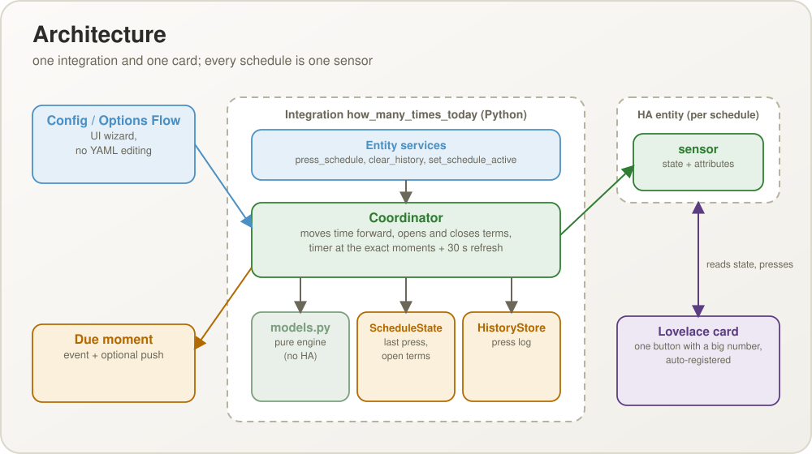

  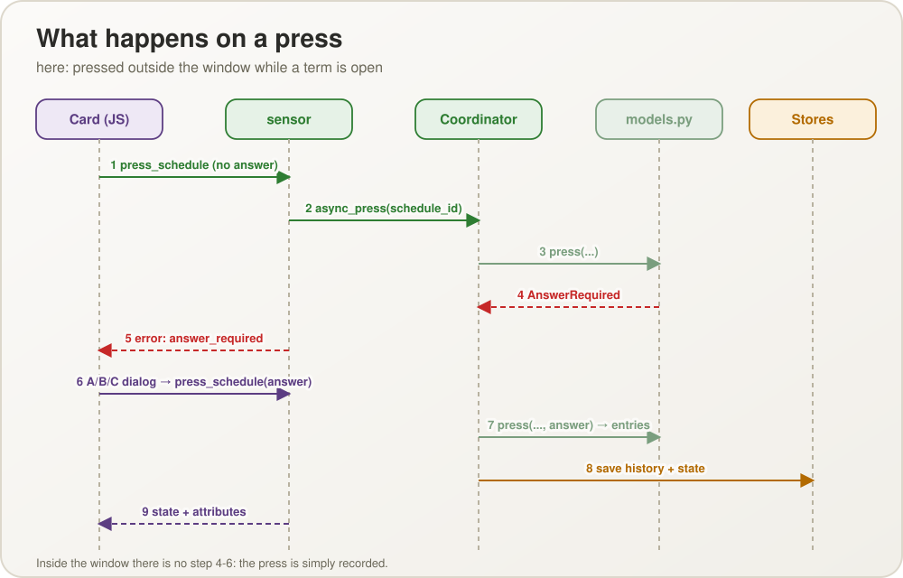

## Schedules and terms

Any number of schedules can be created, edited and removed. Each has:

- a **name** and an optional **description** (the text under the button, in the
  notification and above the history);
- a **start** (date and time, by default the moment of creation) and an optional **end**;
- a **mode**:
  - **Fixed times** — 1 to 24 times a day, each at its own `HH:MM`, not necessarily
    evenly spaced. The planned count per day is the number of times.
  - **Every X hours** — no list of times. The **first term is exactly the start**; each
    next term is the previous plus X hours, across midnight. The planned count per day
    is `24 ÷ X` rounded up (12 h → 2, 8 h → 3, 5 h → 5);
- a **tolerance window** (default 30 minutes before and after a term, adjustable per
  schedule).

A **term** is one moment the schedule is due (07:00 and 16:00 are the two terms of the
day). Terms are derived from the definition; only unresolved terms and a few recently
resolved ones are kept as state.

  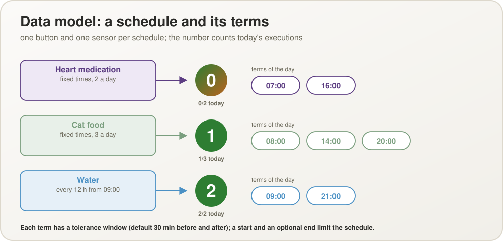

  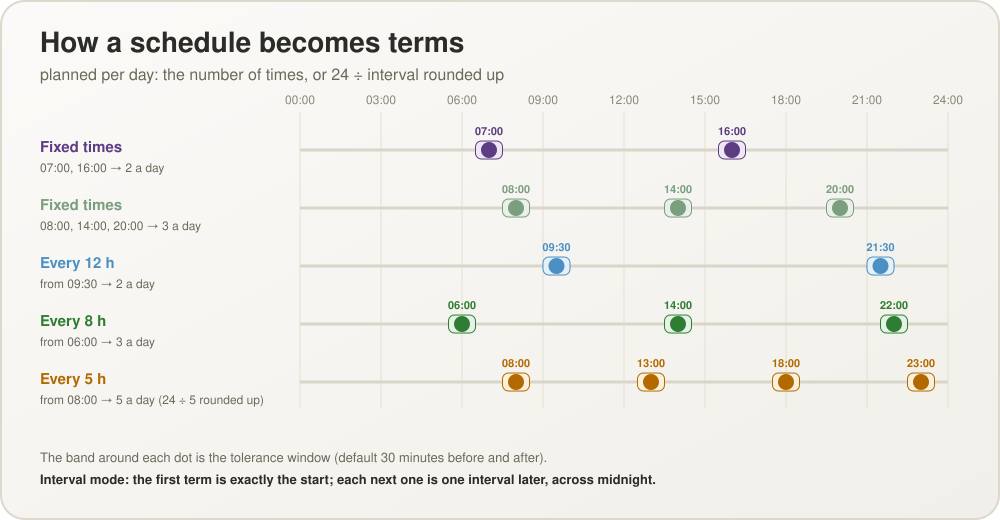

## The button, the counter and the colours

One button and one entity per schedule, with the description under it. The big number on
the button is how many times it was done **today**; every press is an execution, the
counter grows by one and a history entry is written. The counter resets at midnight; the
colour cycle goes on across it.

Colour around a term T:

| Moment | Look | Meaning |
| --- | --- | --- |
| After an execution | green, white number | Everything is fine |
| From the execution to T | green up to 35 % of the way, then to yellow (reached at 55 %: "the time is coming"), then to red | The term approaches |
| T (to T + window) | red, white number | Due now; the due alert goes out |
| T + window (30 min) | blinks black | Overdue; keeps blinking (black and light grey) until the term is closed |
| T + ¾ of the gap to the next term | (still blinking) | Declared missed: a MISSED entry in the log |
| Out-of-window execution within the plan | the number blinks | A warning; the next press stops it and is judged afresh |
| More executions than planned (e.g. 5 of 3) | red, black number, no blinking | Too many; lasts until midnight |

The gap after the last term of a day counts to the first term of the next day; in every
X hours mode the gap is X. Black (an unresolved term) has priority over the other states.

  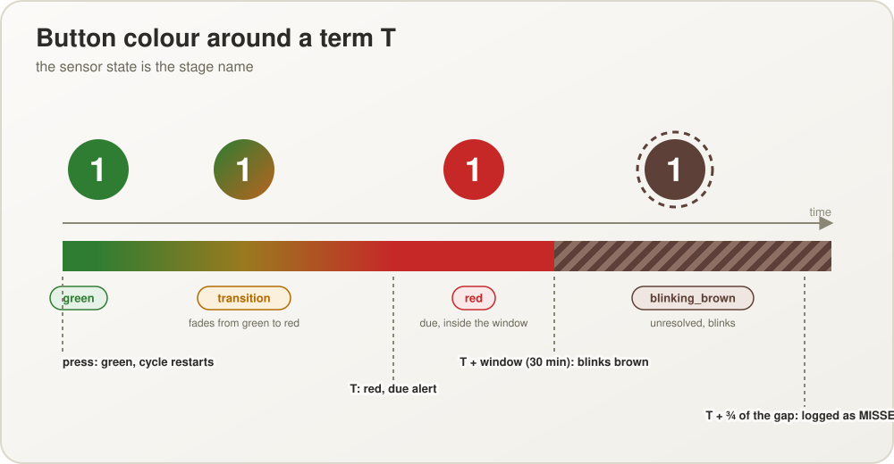

The sensor state is the single source of truth for the look. Priority, highest first:
`inactive`, `pending`, `blinking_black`, `exceeded`, `red`, `transition`, `green`.

  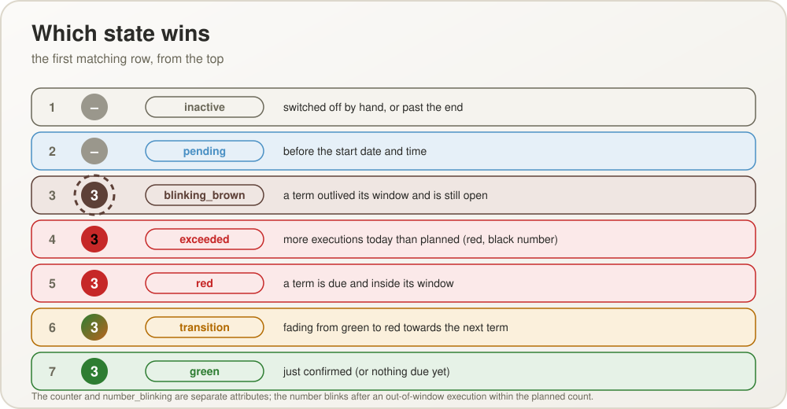

  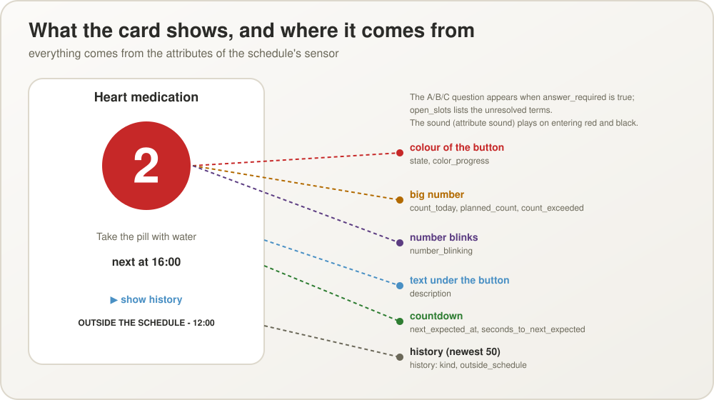

## Pressing: the window and the A/B/C question

The oldest open term decides. A press inside its window is on schedule. A press *before*
a term but inside its window closes that term in advance (no red later). A press outside
the window of the oldest open term asks a question about that term:

| Answer | Term | Count | History |
| --- | --- | --- | --- |
| A `already_done` — it was done, just not recorded | closed as done | +1 | registered late (it is only a record, not a new execution) |
| B `do_now` — it was not done at the term, doing it now | closed as done late | +1 | OUTSIDE THE SCHEDULE with the press time |
| C `extra` — done at the term, and this is an additional one | closed as in A | +2 | as A, plus OUTSIDE THE SCHEDULE |

With several open terms (07:00 missed and 16:00 already red) one press closes one term,
oldest first; the next press handles the next. When no term is open and the press falls between two
terms (see below) the answer decides; with the coming term already closed there is no
question: the press is logged OUTSIDE THE SCHEDULE and the number blinks. A second press inside the
window of an already closed term is such an extra execution too.

  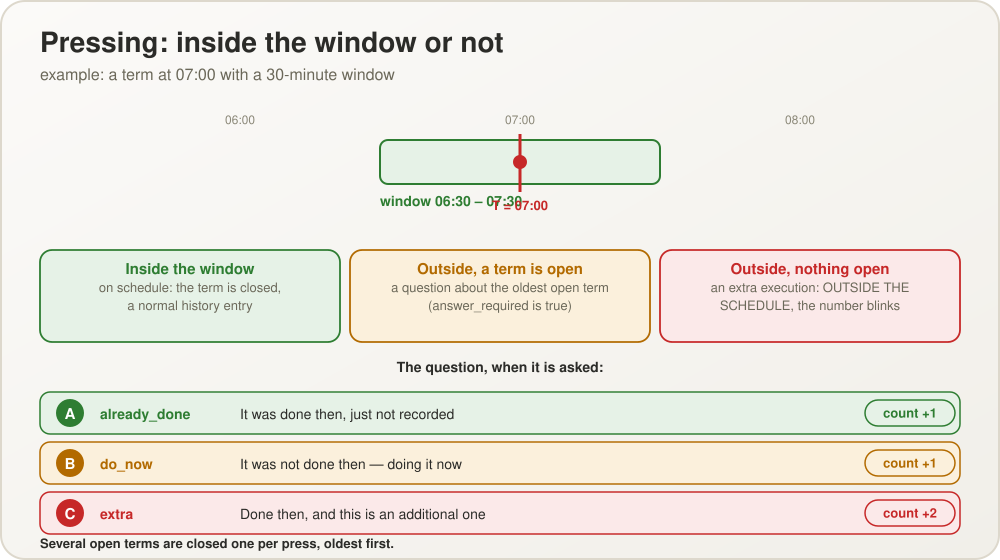

## Pressing between two terms

When no term is open and the coming term's tolerance window has not begun, a press falls
**between two terms** — at any distance from the coming term, there is no time limit. The
question is: is this the **coming occurrence, only done now**, or an extra one?

| Answer | Term | Count | History |
| --- | --- | --- | --- |
| `done_early` — the coming occurrence, done now | the coming term is closed (skipped, it "just happened") | +1 | on schedule, with the term's time |
| `extra` — an additional one | stays due | +1 | OUTSIDE THE SCHEDULE |

After `done_early` the button goes on from green (the fade restarts at this press), never
turns red for the skipped term and the next feeding shown is the one after it. After
`extra` everything behaves as before: the number blinks, the coming term stays due. If the
coming term is already closed (an earlier `done_early`), there is no question: the press is
simply an extra, logged outside the schedule. The question names the coming term's time. When the coming term is further away than a
quarter of the gap since the previous term, `done_early` needs a second confirmation
(`early_far`), because it skips a term that is still far ahead.
The sensor shows `early_by_seconds` while a press would ask; a press without the answer
fails with `early_answer_required`.

## Reminder sounds, text size and contrast

18 synthesised sounds in six classes (gentle, medium, strong, very strong, melody,
seasonal), each recorded at four volume levels; level 0 is silence. The integration has a
default sound and volume (global settings) and every schedule may have its own. The card
plays the sound when the sensor turns `red` and again at `blinking_black`. The text size
(85 – 175 %) and high contrast (white bold on black) are global settings and apply to every
card. The card has a **help** window (**?**) with the version, A-/A+, a contrast switch, the
table of contents, the author and the build date.

## Missed terms and the log

A term nobody closed is declared **missed** after ¾ of the gap to the next term and a
MISSED entry is written (the person may have forgotten, or skipped the action — with
feeding an animal that can be dangerous). The button keeps blinking black; closing the
term does not require any special action — the next press closes it. A term belongs to
the day it falls on: an open term from the previous day stays open (and is logged missed)
although the counter reset at midnight.

## Activity: start, end, switching off

A schedule runs between its start and end. Before the start it is `pending`, after the
end `inactive` (for example an antibiotic for two weeks). It can also be switched off by
hand. A pending schedule shows a grey button saying it has not started; an inactive one has its
card hidden on the dashboard (grey only while the dashboard is being edited, so it can be
selected and switched back on). Neither sends alerts, writes no MISSED entries and refuses presses; its
history stays available and it can be removed. Switching back on does not backfill the
time spent off. A schedule created a few minutes after its start still shows its first
term as due, but terms older than the tolerance window are not backfilled.

  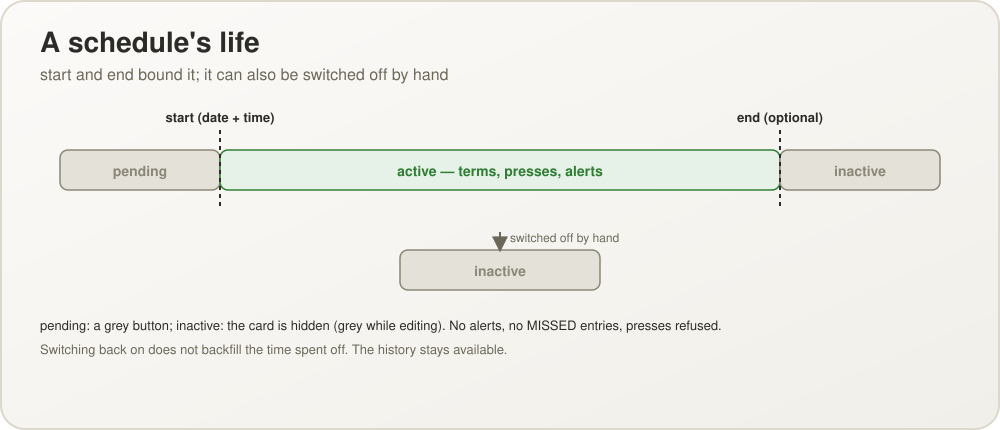

## Notifications

At the moment a term comes due the sensor turns red, once, on the exact second (a timer
is armed for the next moment anything changes, besides the 30-second refresh):

- an **in-app message** with the description appears while a Home Assistant panel is
  open, together with the blinking and the sound;
- the event `how_many_times_today_due` is fired (`entity_id`, `name`, `description`,
  `scheduled_at`) after the entity has taken its new state;
- optionally a **push** through the Home Assistant Companion app (`notify.mobile_app_*`),
  with the description as its text; it works with the app closed.

Nothing repeats at black or when a term is logged missed. No alert is sent for a term that
came due while Home Assistant was down.

  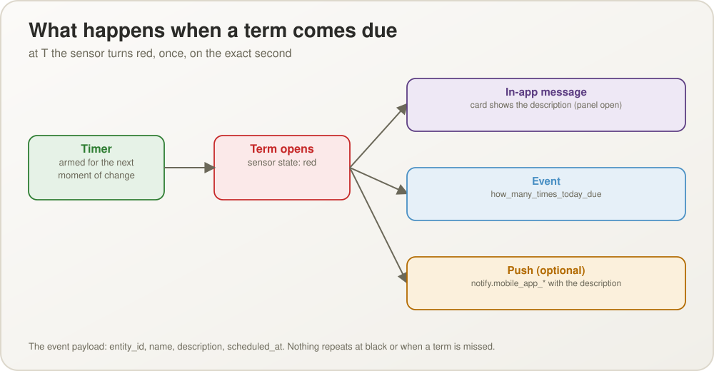

## History

- A log per schedule: each entry is an event type plus data — `kind`, `timestamp`,
  `scheduled_at`, `outside_schedule`, `count_delta` — never ready-made text.
- Entries that follow the schedule are shown in a regular font; the others with the bold
  prefix "OUTSIDE THE SCHEDULE - " and the press time.
- Clearing: entirely, or selectively by chosen ISO weeks (not just "the last N weeks"),
  for one schedule or for all of them.

  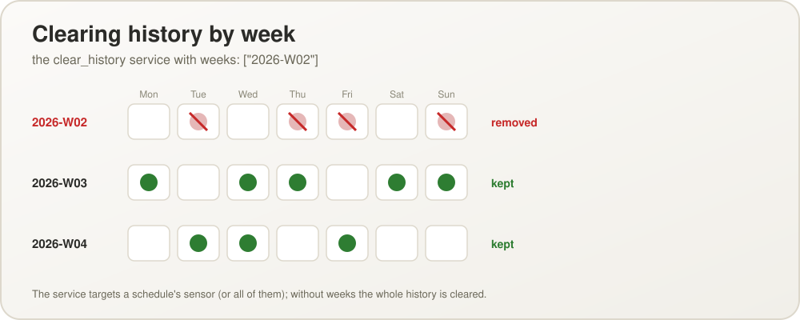

## State persistence across Home Assistant restarts

- Each schedule's state (last press, open terms, the blinking number, the switched-off
  flag) is stored separately from the history and restored on startup; today's counter is
  derived from the history, so it needs no storage of its own.
- A restart does **not** reset the cycle: a term that came due while Home Assistant was
  down is still open afterwards and shows black. A missed dose must not look "on time"
  just because Home Assistant was restarted.
- The stored state of a removed schedule is dropped; a corrupt saved entry for one
  schedule is skipped and does not affect the others.

  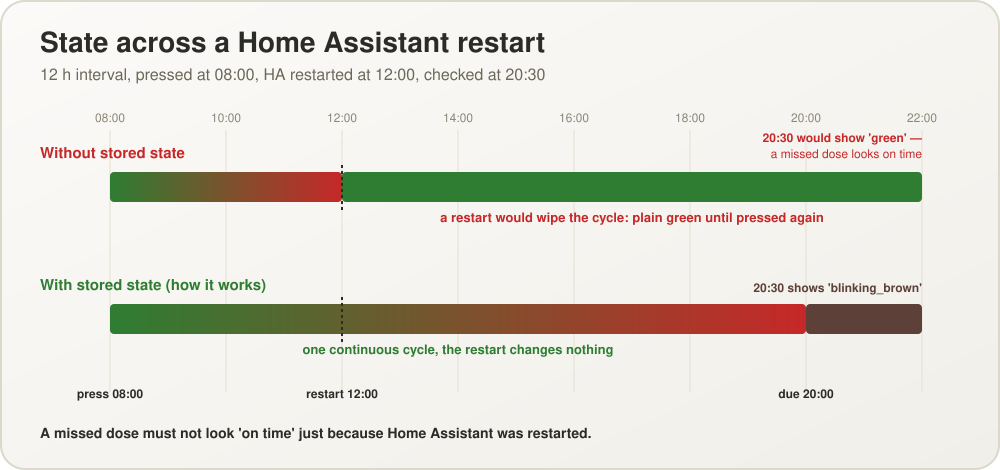

  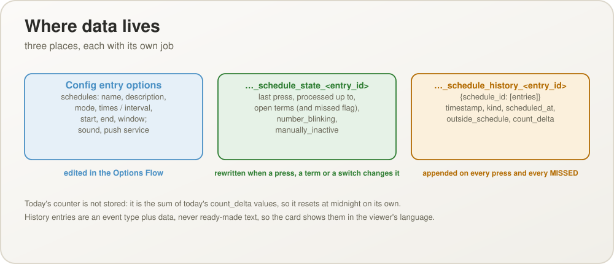

## Multilingual support

- Languages: Polish, English (US), English (GB), German, Russian, Ukrainian, Simplified
  Chinese. Home Assistant does not distinguish English regional variants for component
  translations, so both English variants map to a single `en` file.
- HMTT is shown **in the language of the logged-in Home Assistant user**; when that
  language is outside this set it falls back to English.
- Both halves of the UI are covered: the backend (Config/Options Flow, entity states,
  errors, services in `translations/{en,pl,de,ru,uk,zh-Hans}.json`) and the card's own
  static strings (`CARD_STRINGS` in the card JS, keyed by `hass.language`).
- History entries are stored as data, so the card renders them in the language of whoever
  is looking, not of whoever pressed.

  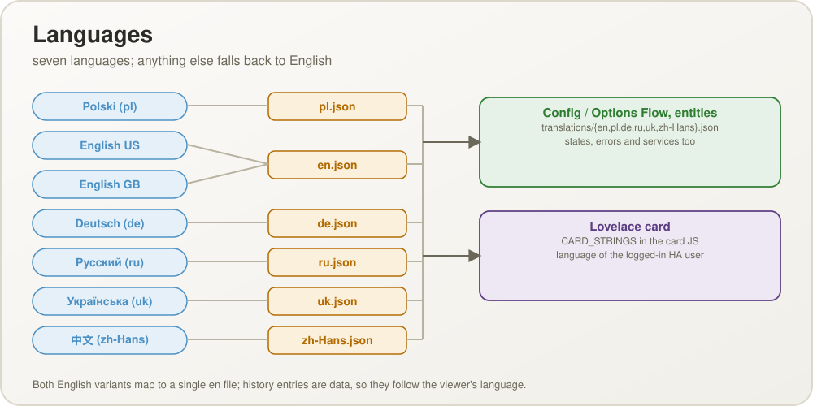

## Time zone

Terms, start and end dates and the midnight reset all follow the time zone configured in
Home Assistant, not the browser's or the server's.

## Services and attributes

Five entity services (`press_schedule`, `clear_history`, `set_schedule_active`, `reset_schedule`, `update_schedule`), the
sensor attributes and the due event are described in the
[configuration guide](CONFIGURATION.md). A press that needs an answer and has none fails
with a validation error whose translation key is `answer_required`.

## Card layouts and adding the integration

The card has two looks chosen per card with `layout: card | tile` (default `card`): the
large card with the description and the expandable history, and a tile with the content of the Android app's card without the history (circle with the
number, name, description, state sentence, countdown, "last / total" and the pencil that opens the edit dialog). A tile presses on a tap (after a short wait, so that a double tap
is not two presses), opens the schedule's edit dialog on a double tap, a double click or
Alt+Enter (the card editor's form with Reset to "all on time" and Close) and opens the history on
a long press, a right click or Shift+Enter; its dialogs are attached to the page body so
they do not depend on the tile's height. The config flow creates the single entry at once
(no form) and accepts an import, which is triggered by a bare `how_many_times_today:` line
in `configuration.yaml` when no entry exists yet.

## Reset to "all on time"

`models.reset_to_on_schedule` puts a switched-on schedule in the state where everything
due so far today was done on time: every term of today up to now, and every term still
open from earlier, is closed; terms resolved in advance for later today are forgotten;
the blinking number stops; today's history is replaced by one `on_schedule` entry per
term due today, stamped with the term's own time (`count_delta` 1), while earlier days
are kept. A switched-off or not yet started schedule raises `ScheduleNotActive`. It is
offered as a step of the Configure dialog and as the `reset_schedule` entity service.

## Testing

150 unit tests run without a Home Assistant installation; see
[TESTING.md](TESTING.md).
