# Specyfikacja funkcjonalna — How Many Times Today

([wersja angielska](SPECIFICATION.md))

Integracja Home Assistant z własną kartą Lovelace do rzeczy, które trzeba zrobić określoną
liczbę razy dziennie (leki, karmienie zwierząt, picie wody, cokolwiek cyklicznego). Każda
taka rzecz to **harmonogram**; każdy harmonogram ma jeden klawisz, jeden sensor i licznik
dzisiejszych wykonań. Konfigurację opisuje
[przewodnik konfiguracji](CONFIGURATION.pl.md).

## Architektura

- **Custom Integration** (`custom_components/how_many_times_today/`) — backend:
  harmonogramy, terminy, liczniki, historia, encje HA, usługi. Konfiguracja wyłącznie
  przez Config Flow i Options Flow (kreator w UI, bez edycji YAML).
- **Custom Lovelace Card** (`custom_components/how_many_times_today/www/`) — frontend:
  klawisz z kolorem, dużą liczbą i miganiem, pytanie A/B/C, komunikat w aplikacji.
  Dołączona wewnątrz pakietu integracji; integracja sama ją rejestruje i wstrzykuje —
  bez ręcznego dodawania zasobu Lovelace.
- Instalacja: skopiuj `custom_components/how_many_times_today` do katalogu
  `custom_components/` Home Assistanta i zrestartuj.

  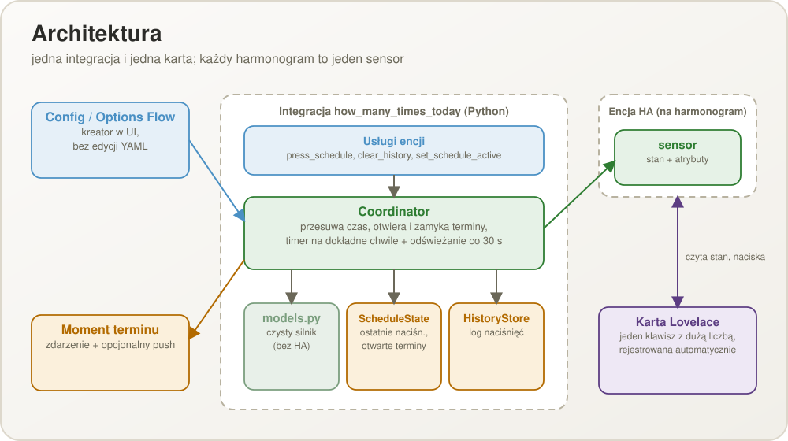

  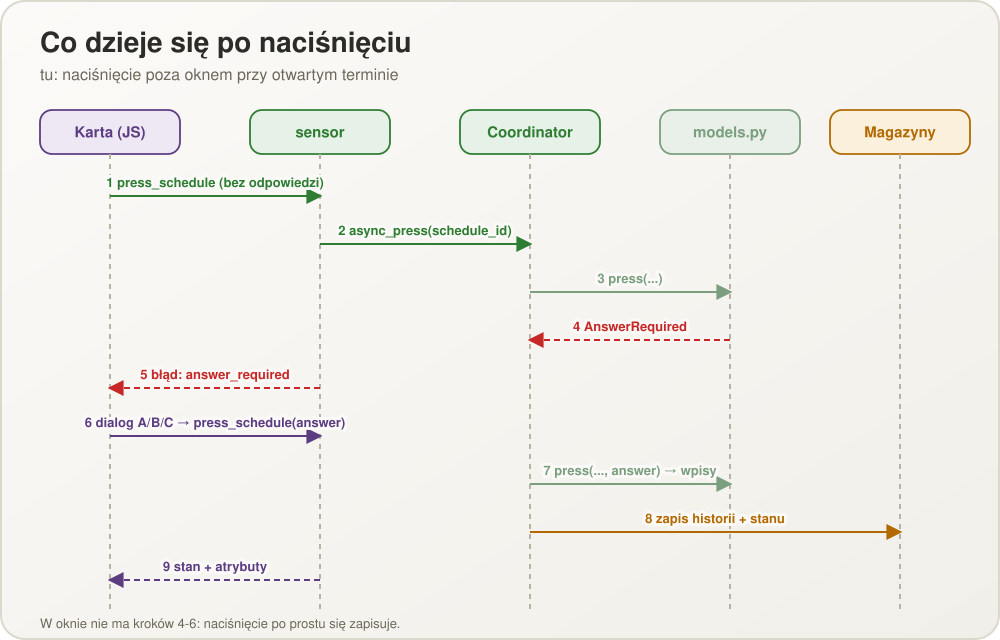

## Harmonogramy i terminy

Można tworzyć, edytować i usuwać dowolnie wiele harmonogramów. Każdy ma:

- **nazwę** i opcjonalny **opis** (tekst pod klawiszem, w powiadomieniu i nad historią);
- **start** (data i godzina, domyślnie moment utworzenia) i opcjonalny **koniec**;
- **tryb**:
  - **Stałe godziny** — od 1 do 24 razy na dobę, każde o własnej `HH:MM`, niekoniecznie
    równo rozłożone. Planowana liczba na dobę to liczba godzin.
  - **Co X godzin** — bez listy godzin. **Pierwszy termin to dokładnie start**; każdy
    kolejny to poprzedni plus X godzin, także po północy. Planowana liczba na dobę to
    `24 ÷ X` w górę (12 h → 2, 8 h → 3, 5 h → 5);
- **okno tolerancji** (domyślnie 30 minut przed i po terminie, z możliwością zmiany dla
  każdego harmonogramu).

**Termin** to jeden moment, w którym harmonogram jest należny (07:00 i 16:00 to dwa
terminy doby). Terminy wynikają z definicji; jako stan przechowywane są tylko terminy
nierozwiązane i kilka niedawno rozwiązanych.

  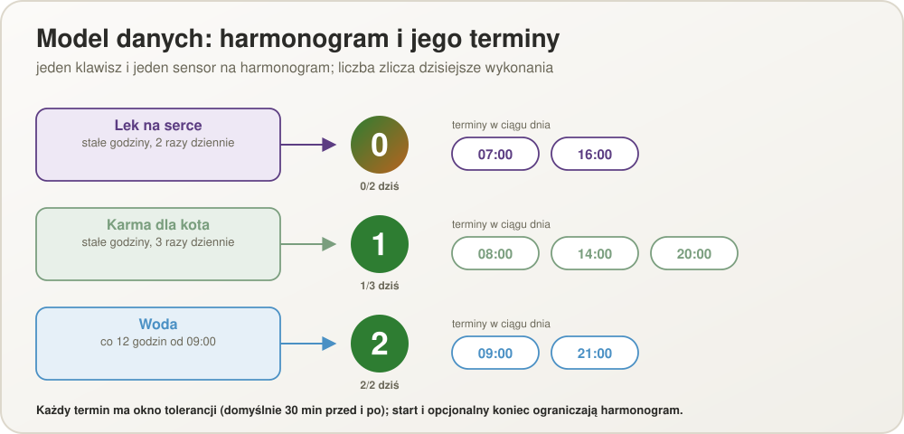

  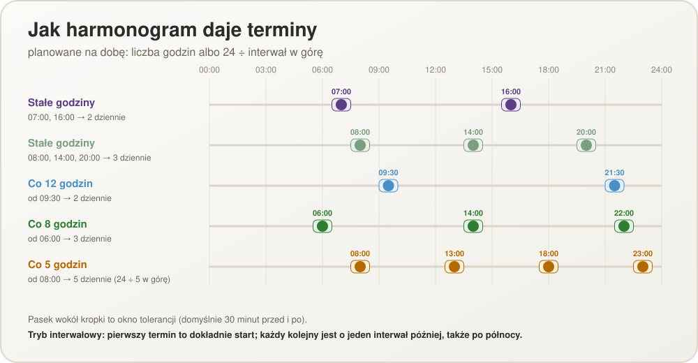

## Klawisz, licznik i kolory

Jeden klawisz i jedna encja na harmonogram, z opisem pod klawiszem. Duża liczba na
klawiszu to ile razy zrobiono to **dzisiaj**; każde naciśnięcie to wykonanie, licznik
rośnie o jeden i powstaje wpis w historii. Licznik zeruje się o północy; cykl kolorów
biegnie dalej.

Kolor wokół terminu T:

| Moment | Wygląd | Znaczenie |
| --- | --- | --- |
| Po wykonaniu | zielony, biała liczba | Wszystko w porządku |
| Od wykonania do T | zielony do 35 % drogi, potem w żółty (osiągany przy 55 %: „zbliża się pora”), potem w czerwony | Zbliża się termin |
| T (do T + okno) | czerwony, biała liczba | Należne teraz; wychodzi alert terminu |
| T + okno (30 min) | miga na czarno | Spóźnienie; miga (czarny i jasnoszary), dopóki termin nie zostanie zamknięty |
| T + ¾ odstępu do następnego terminu | (miga dalej) | Uznany za pominięty: wpis POMINIĘTE w logu |
| Wykonanie poza oknem w granicach planu | liczba miga | Ostrzeżenie; kolejne naciśnięcie je gasi i jest oceniane od nowa |
| Więcej wykonań niż zaplanowano (np. 5 z 3) | czerwony, czarna liczba, bez migania | Za dużo; utrzymuje się do północy |

Odstęp po ostatnim terminie doby liczy się do pierwszego terminu następnej doby; w trybie
co X godzin odstęp to X. Czerń (nierozwiązany termin) ma pierwszeństwo przed pozostałymi
stanami.

  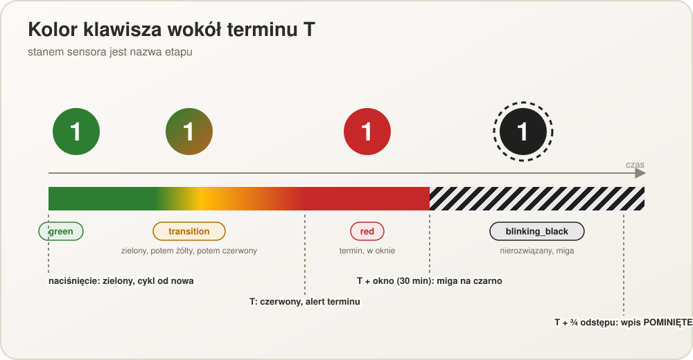

Stan sensora jest jedynym źródłem prawdy o wyglądzie. Priorytet, od najwyższego:
`inactive`, `pending`, `blinking_black`, `exceeded`, `red`, `transition`, `green`.

  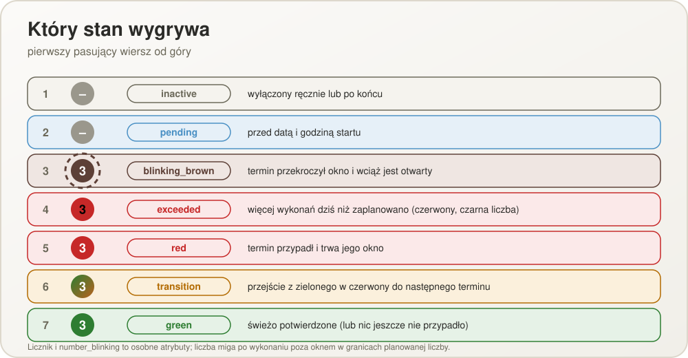

  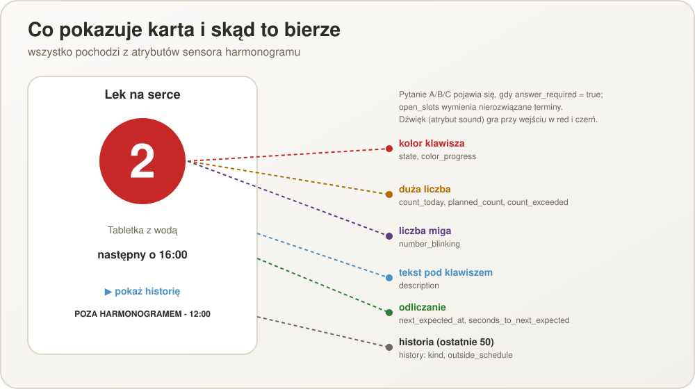

## Naciśnięcie: okno i pytanie A/B/C

Decyduje najstarszy otwarty termin. Naciśnięcie w jego oknie jest zgodne z harmonogramem.
Naciśnięcie *przed* terminem, ale w jego oknie, zamyka ten termin z góry (później nie
będzie czerwieni). Naciśnięcie poza oknem najstarszego otwartego terminu zadaje pytanie o
ten termin:

| Odpowiedź | Termin | Licznik | Historia |
| --- | --- | --- | --- |
| A `already_done` — było zrobione, tylko nie zapisane | zamknięty jako wykonany | +1 | zarejestrowane z opóźnieniem (to tylko zapis, nie nowe wykonanie) |
| B `do_now` — nie zrobiono w terminie, robię teraz | zamknięty jako wykonany z opóźnieniem | +1 | POZA HARMONOGRAMEM z godziną naciśnięcia |
| C `extra` — zrobione w terminie, a to jest dodatkowe | zamknięty jak w A | +2 | jak A oraz POZA HARMONOGRAMEM |

Przy kilku otwartych terminach (07:00 pominięty i 16:00 już czerwony) jedno naciśnięcie
zamyka jeden termin, od najstarszego; kolejne obsługuje następny. Gdy żaden termin nie
jest otwarty, a naciśnięcie wypada między dwoma terminami (patrz niżej), decyduje odpowiedź;
gdy nadchodzący termin jest już zamknięty, pytania nie ma: naciśnięcie zapisuje się jako
POZA HARMONOGRAMEM, a liczba miga. Drugie naciśnięcie w oknie już zamkniętego terminu to także takie dodatkowe
wykonanie.

  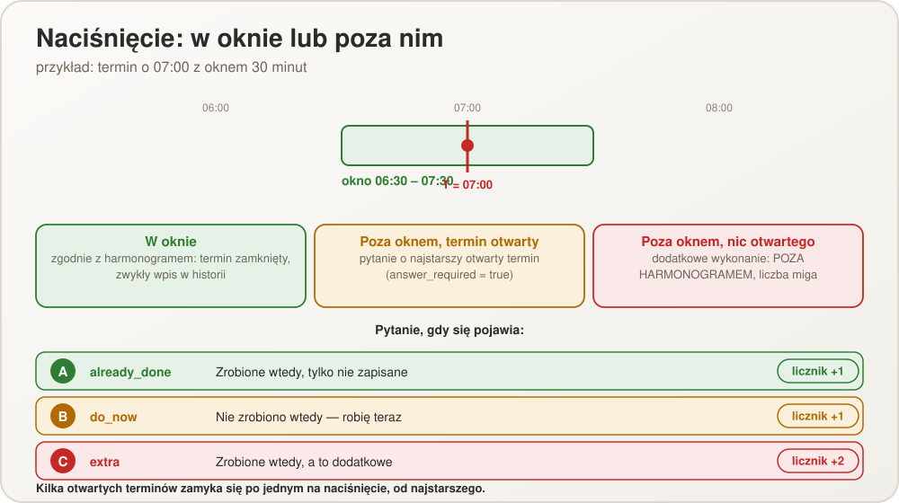

## Naciśnięcie między dwoma terminami

Gdy żaden termin nie jest otwarty, a okno tolerancji nadchodzącego terminu jeszcze się nie
zaczęło, naciśnięcie wypada **między dwoma terminami** — w dowolnej odległości od
nadchodzącego terminu, bez limitu czasu. Pytanie brzmi: czy to jest **nadchodzące
wystąpienie, tylko wykonane teraz**, czy dodatkowe?

| Odpowiedź | Termin | Licznik | Historia |
| --- | --- | --- | --- |
| `done_early` — nadchodzące wystąpienie, wykonane teraz | nadchodzący termin zostaje zamknięty (przeskoczony, bo „właśnie wystąpił”) | +1 | zgodnie z harmonogramem, z godziną terminu |
| `extra` — dodatkowe | pozostaje należny | +1 | POZA HARMONOGRAMEM |

Po `done_early` klawisz idzie dalej od zielonego (przejście zaczyna się od tego naciśnięcia),
nigdy nie robi się czerwony dla przeskoczonego terminu, a pokazywane następne karmienie to to
po nim. Po `extra` wszystko działa jak dotąd: liczba miga, nadchodzący termin pozostaje
należny. Jeśli nadchodzący termin jest już zamknięty (wcześniejsze `done_early`), pytania nie
ma: naciśnięcie jest po prostu dodatkowe, zapisane poza harmonogramem. Pytanie podaje
godzinę nadchodzącego terminu. Sensor pokazuje `early_by_seconds`, gdy naciśnięcie zadałoby
pytanie; naciśnięcie bez odpowiedzi kończy się błędem `early_answer_required`.

## Dźwięki przypomnień, rozmiar tekstu i kontrast

18 dźwięków syntetyzowanych w sześciu klasach (delikatne, średnie, mocne, bardzo mocne,
melodie, okolicznościowe), każdy nagrany w czterech poziomach głośności; poziom 0 to cisza.
Integracja ma dźwięk i głośność domyślne (ustawienia globalne), a każdy harmonogram może mieć
własne. Karta gra dźwięk, gdy sensor robi się `red`, i ponownie przy `blinking_black`.
Rozmiar tekstu (85 – 175 %) i wysoki kontrast (biały pogrubiony tekst na czarnym) to ustawienia
globalne i dotyczą każdej karty. Karta ma okno **pomocy** (**?**) z wersją, A-/A+, przełącznikiem
kontrastu, spisem treści, autorem i datą kompilacji.

## Pominięcia i logi

Termin, którego nikt nie zamknął, jest uznawany za **pominięty** po ¾ odstępu do
następnego terminu i powstaje wpis POMINIĘTE (osoba mogła zapomnieć albo zaniechać
czynności — przy karmieniu zwierzęcia to może być niebezpieczne). Klawisz dalej miga na
czarno; zamknięcie terminu nie wymaga niczego specjalnego — zamyka go kolejne
naciśnięcie. Termin należy do doby, na którą przypada: otwarty termin z poprzedniej doby
pozostaje otwarty (i zapisze POMINIĘTE) mimo zerowania licznika o północy.

## Aktywność: start, koniec, wyłączenie

Harmonogram działa między startem a końcem. Przed startem jest `pending`, po końcu
`inactive` (np. antybiotyk przez dwa tygodnie). Można go też wyłączyć ręcznie.
Oczekujący harmonogram pokazuje szary klawisz z informacją, że jeszcze się nie zaczął;
nieaktywny ma kartę ukrytą na pulpicie (szarą tylko podczas edycji pulpitu, więc można ją
zaznaczyć i włączyć z powrotem). Żaden nie wysyła alertów, nie zapisuje wpisów POMINIĘTE i odrzuca
naciśnięcia; historia pozostaje dostępna i można go usunąć. Ponowne włączenie nie nadrabia
czasu wyłączenia. Harmonogram utworzony kilka minut po starcie nadal pokazuje pierwszy
termin jako należny, ale terminy starsze niż okno tolerancji nie są nadrabiane.

  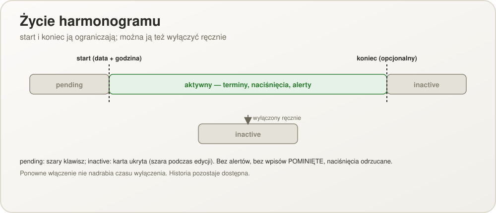

## Powiadomienia

W chwili, gdy termin przypada, sensor robi się czerwony, raz, co do sekundy (poza
odświeżaniem co 30 sekund uzbrajany jest timer na następną chwilę jakiejkolwiek zmiany):

- pojawia się **komunikat w aplikacji** z opisem, gdy otwarty jest panel Home Assistanta,
  razem z miganiem i dźwiękiem;
- odpalane jest zdarzenie `how_many_times_today_due` (`entity_id`, `name`, `description`,
  `scheduled_at`) po tym, jak encja przyjęła nowy stan;
- opcjonalnie **push** przez aplikację Home Assistant Companion (`notify.mobile_app_*`), z
  opisem jako treścią; działa przy zamkniętej aplikacji.

Nic się nie powtarza przy czarnym ani gdy termin trafia do logu jako pominięty. Nie
wysyła się alertu dla terminu, który przypadł, gdy Home Assistant był wyłączony.

  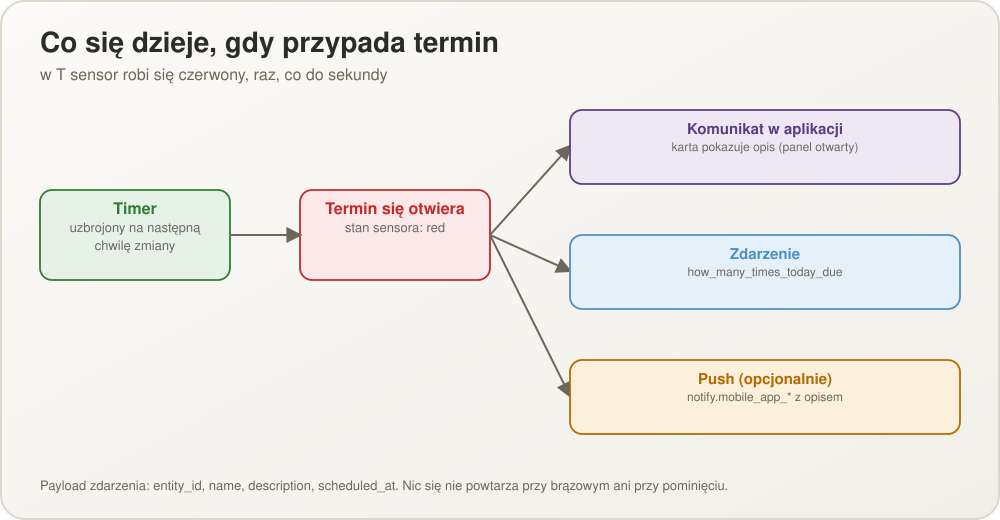

## Historia

- Log per harmonogram: każdy wpis to typ zdarzenia plus dane — `kind`, `timestamp`,
  `scheduled_at`, `outside_schedule`, `count_delta` — nigdy gotowy tekst.
- Wpisy zgodne z harmonogramem w zwykłej czcionce; pozostałe z pogrubionym przedrostkiem
  „POZA HARMONOGRAMEM - ” i godziną naciśnięcia.
- Czyszczenie: całość albo wybiórczo po wskazanych tygodniach ISO (nie tylko „ostatnie N
  tygodni”), dla jednego harmonogramu lub wszystkich.

  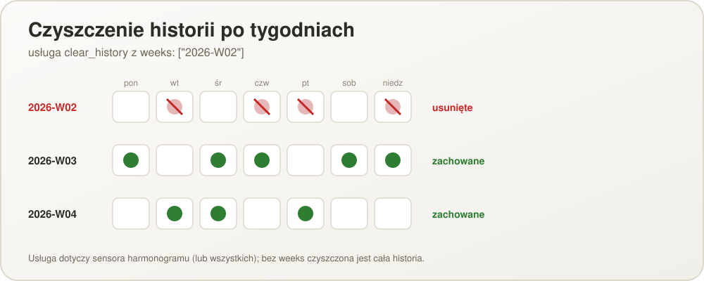

## Trwałość stanu po restarcie Home Assistanta

- Stan każdego harmonogramu (ostatnie naciśnięcie, otwarte terminy, migająca liczba,
  flaga ręcznego wyłączenia) jest zapisywany osobno od historii i odtwarzany przy starcie;
  dzisiejszy licznik wynika z historii, więc nie ma własnego zapisu.
- Restart **nie** zeruje cyklu: termin, który przypadł, gdy Home Assistant był wyłączony,
  po starcie nadal jest otwarty i pokazuje czerń. Pominięta dawka nie może wyglądać na „w
  terminie” tylko dlatego, że Home Assistant był restartowany.
- Zapis stanu usuniętego harmonogramu jest porzucany; uszkodzony zapis jednego
  harmonogramu jest pomijany i nie wpływa na pozostałe.

  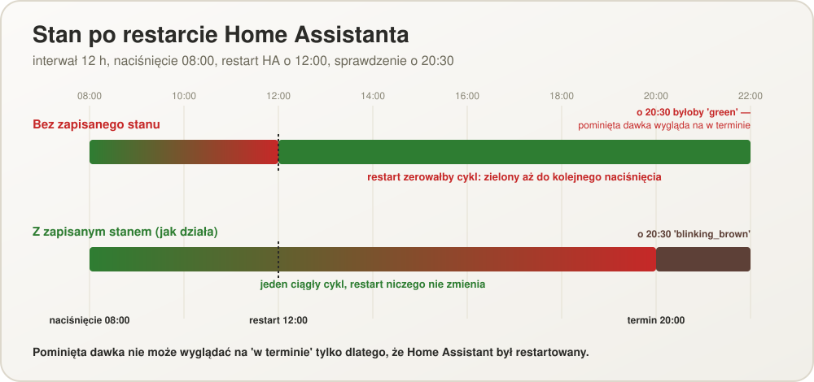

  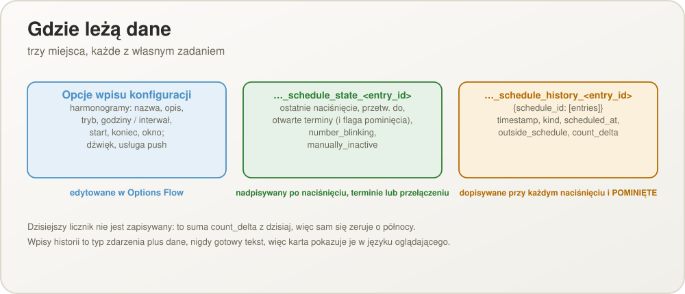

## Wielojęzyczność

- Języki: polski, angielski (US), angielski (GB), niemiecki, rosyjski, ukraiński, chiński
  uproszczony. Home Assistant nie rozróżnia regionalnych wariantów angielskiego w
  tłumaczeniach komponentów, więc oba warianty trafiają do jednego pliku `en`.
- HMTT wyświetla się **w języku zalogowanego użytkownika Home Assistanta**; gdy ten język
  jest poza zestawem, wraca do angielskiego.
- Obejmuje obie połówki UI: backend (Config/Options Flow, stany encji, błędy, usługi w
  `translations/{en,pl,de,ru,uk,zh-Hans}.json`) i własne statyczne teksty karty
  (`CARD_STRINGS` w JS karty, klucz `hass.language`).
- Wpisy historii są zapisywane jako dane, więc karta renderuje je w języku tego, kto
  patrzy, a nie tego, kto nacisnął.

  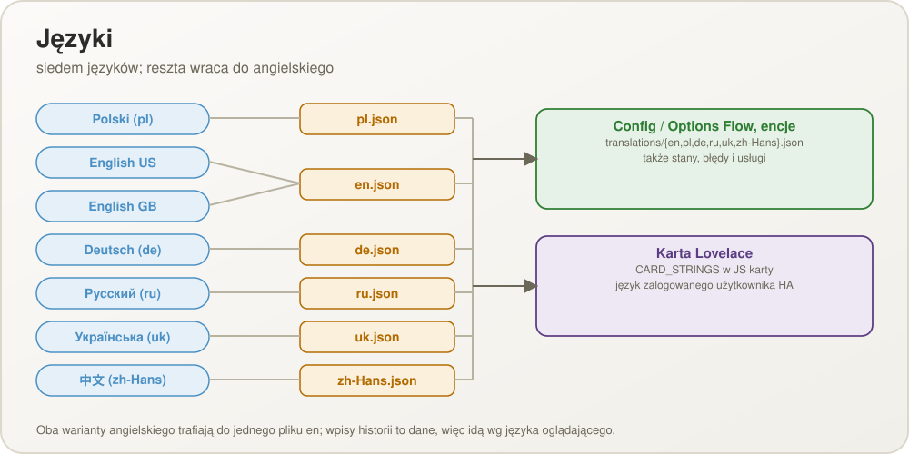

## Strefa czasowa

Terminy, daty startu i końca oraz zerowanie o północy podążają za strefą czasową
skonfigurowaną w Home Assistant, a nie przeglądarki czy serwera.

## Usługi i atrybuty

Pięć usług encji (`press_schedule`, `clear_history`, `set_schedule_active`, `reset_schedule`, `update_schedule`), atrybuty
sensora i zdarzenie terminu opisuje [przewodnik konfiguracji](CONFIGURATION.pl.md).
Naciśnięcie, które wymaga odpowiedzi, a jej nie ma, kończy się błędem walidacji z kluczem
tłumaczenia `answer_required`.

## Wygląd karty i dodawanie integracji

Karta ma dwa wyglądy wybierane osobno dla każdej karty przez `layout: card | tile`
(domyślnie `card`): dużą kartę z opisem i rozwijaną historią oraz kafelek z zawartością karty z aplikacji na Androida bez historii (kółko z liczbą,
nazwa, opis, zdanie stanu, odliczanie, „ostatnio / łącznie” i ołówek otwierający okno edycji). Kafelek naciska po dotknięciu (po krótkiej chwili, żeby podwójne dotknięcie nie były dwoma
naciśnięciami), okno edycji harmonogramu otwiera po podwójnym dotknięciu, podwójnym kliknięciu
lub Alt+Enter (formularz z edytora karty z Resetuj do „wszystko o czasie” i Zamknij), a historię po długim
przytrzymaniu, prawym kliku lub Shift+Enter; jego okna są doczepione do body strony, więc
nie zależą od wysokości kafelka. Przepływ konfiguracji tworzy jedyny wpis od razu (bez
formularza) i przyjmuje import, który uruchamia samo `how_many_times_today:` w
`configuration.yaml`, gdy wpisu jeszcze nie ma.

## Reset do „wszystko na czas”

`models.reset_to_on_schedule` ustawia włączony harmonogram w stan, w którym wszystko, co
do tej pory dziś przypadało, zrobiono na czas: każdy dzisiejszy termin do teraz i każdy
wciąż otwarty termin z wcześniejszych dni zostaje zamknięty; terminy rozstrzygnięte z
wyprzedzeniem na później dziś są zapominane; migająca liczba przestaje migać; dzisiejsza
historia jest zastępowana jednym wpisem `on_schedule` na każdy dzisiejszy termin, z
godziną samego terminu (`count_delta` 1), a wcześniejsze dni zostają. Harmonogram
wyłączony lub jeszcze niezaczęty zgłasza `ScheduleNotActive`. Reset jest krokiem okna
Konfiguruj i usługą encji `reset_schedule`.

## Testy

150 testów jednostkowych działa bez instalacji Home Assistanta; zobacz
[TESTING.pl.md](TESTING.pl.md).
