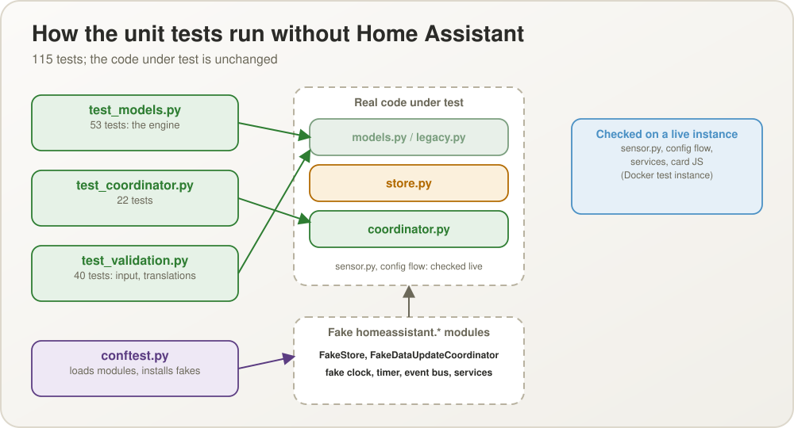
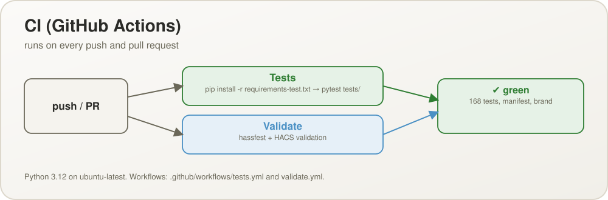

# Testing

([Polish version](TESTING.pl.md))

## Unit tests (pytest)

145 tests, no Home Assistant installation needed:

```sh
pip install -r requirements-test.txt
python -m pytest tests/ -v
```

- `tests/test_models.py` (76): the pure scheduling engine (`models.py`) — terms for
  fixed-times and every-X-hours schedules (start, end, midnight, fractional hours,
  absolute durations across a daylight-saving change), the planned count, the gap and the
  ¾ "missed" moment, and the whole press logic: inside and before the window, the A/B/C
  answers, oldest open term first, extra executions, the blinking number, the exceeded
  state, state priority, colour progress, pending / inactive / switched off, the due event
  freshness, long downtimes, the runtime round-trip, and validating a change to a stored schedule (`update_schedule`) and the reset to "all on time".
- `tests/test_coordinator.py` (26): the coordinator and the stores against fake Home
  Assistant pieces — state and history surviving a simulated restart (an open term stays
  open), a corrupt saved entry being skipped, presses (an answer needed, catching up
  terms that came due), switching on/off, clearing history (one schedule, all, by week),
  the due event payload and its single delivery, the optional push (and a failing
  notifier), the exact-moment timer and its cancellation, and schedules added, edited and
  removed through the options, changing a schedule through the service, and the reset (history of today replaced, earlier days kept, inactive schedules skipped).
- `tests/test_validation.py` (40): input helpers of the config flow (`normalize_hhmm`,
  `normalize_local_datetime`, `default_times`), the one-off conversion from the previous
  task/slot data (`legacy.py`), and translation completeness — the same keys in
  `strings.json` and every `translations/*.json`, all six languages present and actually
  translated, every state, error, service and form step the code uses has a text.
- `tests/test_card.py` (3): static checks of the card's JavaScript — it parses (`node --check`,
  skipped when Node.js is missing), every language block of its strings has the same keys,
  and the card and its editor tolerate Home Assistant handing over `hass` before the config.
- `tests/conftest.py` makes this possible without Home Assistant: it loads the
  integration's modules directly (bypassing `__init__.py`, which imports
  `homeassistant`) and installs minimal fake `homeassistant.*` modules — an in-memory
  `Store` (class-level, so a test can "restart" by building a new coordinator over the
  same storage; it round-trips data through JSON like the real one), a `DataUpdateCoordinator`
  that also runs the tasks created during a refresh (as Home Assistant does once the
  entities have taken the new state), a fake clock, a timer registry, an event bus and a
  service registry. The tested code itself is unchanged. Async code is run with plain
  `asyncio.run`, so no pytest-asyncio.
- CI runs the same command on every push/PR (`.github/workflows/tests.yml`, Python 3.12)
  next to the hassfest / HACS validation. `sensor.py`, the config flow and the card JS are
  **not** covered by unit tests — they are exercised in the Docker instance below.

<p align="center">
  
</p>

<p align="center">
  
</p>

## Local test environment (Docker)

A persistent Home Assistant instance for manually testing this integration end-to-end,
running in Docker.

### Setup

- Container: `hmtt-test-ha` (image `ghcr.io/home-assistant/home-assistant:stable`)
- Port: `8123` (http://localhost:8123)
- Persistent config volume: `.ha-test-config/` (gitignored — contains the real auth
  database, do not commit it)
- The integration code is bind-mounted live from `custom_components/how_many_times_today/`
  into the container's `/config/custom_components/how_many_times_today/` — editing files on
  disk changes what the container sees immediately.
- Onboarded non-interactively via the REST onboarding API. Admin credentials are in
  `.ha-test-config/CREDENTIALS.local.txt` (gitignored, local only).
- The instance's Home Assistant time zone is UTC unless you change it; schedules follow
  that zone, so "09:00" is 09:00 UTC there.

**Do not remove this container or its config volume** — it is meant to be reused, not
recreated each time.

### Restarting after a code change

Home Assistant's "reload" action re-runs `async_setup_entry` on the **already-imported**
Python module — it does **not** re-read `.py` files from disk. Editing
`custom_components/how_many_times_today/*.py` requires a full container restart:

```sh
docker restart hmtt-test-ha
```

(A fix can look as if it did nothing because "reload" silently kept the old bytecode —
always suspect this first if a just-applied fix does not change the behaviour.)

### Driving it without a browser

The Config/Options Flow can be exercised directly through the REST API
(`/api/config/config_entries/flow`, `/api/config/config_entries/options/flow`), services
through `/api/services/...`, and errors and events through the WebSocket API
(`call_service`, `subscribe_events`) — the WebSocket shows the real error shape
(`code: service_validation_error`, `translation_key`, `translation_domain`). Subscribing to a
custom event such as `how_many_times_today_due` needs an administrator account; non-admin
users only get state changes, which is why the card reacts to the sensor turning `red`. Or
use the real UI at http://localhost:8123 once logged in.

### Known-good manual test sequence

1. Add a fixed-times schedule through the Options Flow (a counter, then one time field per
   execution) → one sensor appears immediately, no restart needed.
2. Add an every-X-hours schedule → no time list; the first term is exactly the start.
3. Create a schedule with a 1-minute tolerance window and a term two minutes ahead →
   at T the sensor turns `red` and `how_many_times_today_due` is fired with
   `entity_id`, `name`, `description`, `scheduled_at`; one minute later it is
   `blinking_brown` with the term in `open_slots` and `answer_required: true`.
4. `press_schedule` without an `answer` at that moment → a validation error with
   `translation_key: answer_required`; with `answer: do_now` → the term closes, the count
   rises and `number_blinking` is true; another press → `exceeded`.
5. `set_schedule_active` with `active: false` → `inactive`, presses refused with
   `schedule_not_active`; back on → it resumes without backfilling.
6. `clear_history` empties the history and today's count; Remove a schedule through the
   options → its sensor disappears immediately.
7. State persistence: press, `docker restart hmtt-test-ha` → `last_pressed_at`,
   `next_expected_at` and the count are identical afterwards, and an open term is still
   open.
8. Card JS is served at `/how_many_times_today_files/how-many-times-today-card.js`
   (auto-registered, no manual Lovelace resource needed).

### Driving a real browser against the instance (headless CDP)

No Playwright/Selenium is installed, but Edge/Chrome's own headless mode plus the raw
Chrome DevTools Protocol (a `websockets` client talking JSON-RPC to
`ws://localhost:9222/devtools/...`) is enough to get a genuine authenticated screenshot:

1. Launch the browser: `msedge.exe --headless=new --remote-debugging-port=9222
   --user-data-dir=<scratch dir>`
2. Open a tab (`PUT /json/new`), connect to its `webSocketDebuggerUrl`
3. Inject an already-obtained access/refresh token pair into `localStorage.hassTokens`
   (shape: `{hassUrl, clientId, refresh_token, access_token, expires: <ms epoch>,
   token_type}`) — this is what a real login ultimately produces, so pre-seeding it skips
   the login form
4. `Page.navigate` and `Page.captureScreenshot`

Gotchas worth checking first:

- **Dark mode needs `localStorage.selectedTheme`, not just the backend user data.**
  `frontend/set_user_data` with key `dark_mode` round-trips fine but is never read by the
  frontend. The real key is `selectedTheme` (e.g. `{"dark": true}`), and the live app only
  reads it from the browser's own `localStorage` at boot.
- **The service worker serves a stale cached `index.html`.** A plain `curl` shows the
  `<script>` tag of a newly registered card, but the browser keeps rendering the old page —
  HA's frontend is a PWA with an aggressive service worker. Fix:
  `Network.setBypassServiceWorker` (CDP) plus `navigator.serviceWorker.getRegistrations()
  .then(rs => rs.forEach(r => r.unregister()))` and clearing `caches`, then a real reload.
- **After changing the card JS, a stale service worker can leave every card on
  "Configuration error"** (`customElements.get('how-many-times-today-card')` is `undefined`
  because the old, cached bundle is served). Same recipe: unregister the service worker,
  clear `caches`, reload. The card itself is served with an `ETag` and `Cache-Control: no-cache`
  (no versioned URL), so editing `www/how-many-times-today-card.js` takes effect on the next
  page load without restarting Home Assistant; only an already-cached service worker can still
  hold an old page.
- Custom dashboard routes saved via `lovelace/config/save` navigate unreliably through
  scripted `Page.navigate`/`pushState`; a real, interactively driven browser opens them
  fine (see `docs/images/screenshot-card-dashboard.jpg`).
