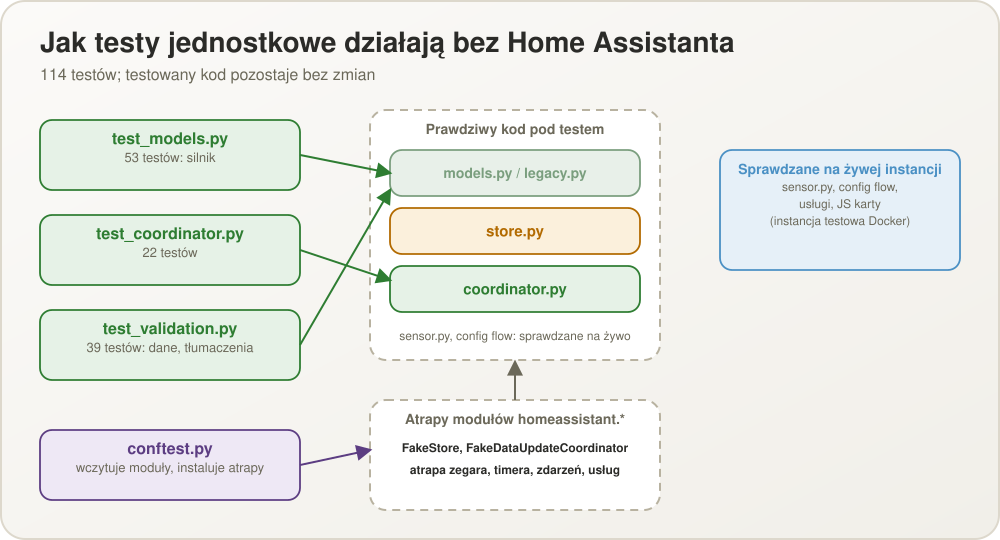
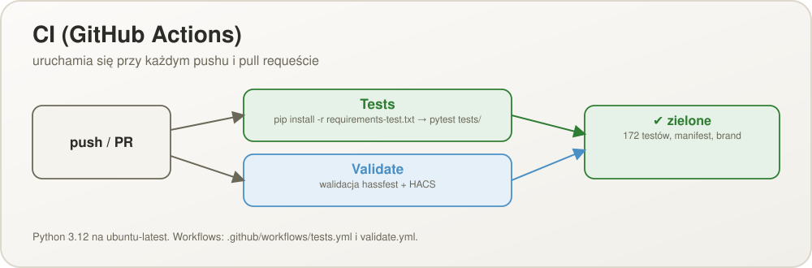

# Testowanie

([English version](TESTING.md))

## Testy jednostkowe (pytest)

146 testów, bez instalacji Home Assistanta:

```sh
pip install -r requirements-test.txt
python -m pytest tests/ -v
```

- `tests/test_models.py` (76): czysty silnik harmonogramów (`models.py`) — terminy dla
  harmonogramów ze stałymi godzinami i co X godzin (start, koniec, północ, ułamkowe
  godziny, bezwzględne czasy trwania przez zmianę czasu), planowana liczba, odstęp i
  moment „pominięcia” po ¾ oraz cała logika naciśnięć: w oknie i przed nim, odpowiedzi
  A/B/C, najstarszy otwarty termin najpierw, wykonania dodatkowe, migająca liczba, stan
  przekroczenia, priorytet stanów, postęp koloru, pending / inactive / wyłączony, świeżość
  zdarzenia terminu, długie przestoje, serializacja stanu oraz walidacja zmiany zapisanego harmonogramu (`update_schedule`) i reset do „wszystko na czas”.
- `tests/test_coordinator.py` (27): koordynator i magazyny na atrapach elementów Home
  Assistanta — stan i historia przeżywające symulowany restart (otwarty termin pozostaje
  otwarty), pominięcie uszkodzonego zapisu, naciśnięcia (potrzebna odpowiedź, nadrabianie
  terminów, które przypadły), włączanie/wyłączanie, czyszczenie historii (jeden
  harmonogram, wszystkie, po tygodniach), payload zdarzenia terminu i jego jednokrotne
  dostarczenie, opcjonalny push (i zepsuty powiadamiacz), timer na dokładną chwilę wraz z
  anulowaniem oraz harmonogramy dodawane, edytowane i usuwane przez opcje zmiana harmonogramu przez usługę oraz reset (dzisiejsza historia zastępowana, niepotrzebne naciśnięcia cofane, wcześniejsze dni zostają, wyłączone pomijane).
- `tests/test_validation.py` (40): pomocnicze funkcje wejścia formularza
  (`normalize_hhmm`, `normalize_local_datetime`, `default_times`), jednorazowa konwersja
  danych z poprzedniego modelu zadań i slotów (`legacy.py`) oraz kompletność tłumaczeń —
  te same klucze w `strings.json` i każdym `translations/*.json`, wszystkie sześć języków
  obecnych i faktycznie przetłumaczonych, każdy stan, błąd, usługa i krok formularza
  używany w kodzie ma tekst.
- `tests/test_card.py` (3): statyczne sprawdzenia JavaScriptu karty — parsuje się (`node
  --check`, pomijane, gdy nie ma Node.js), każdy blok językowy jej napisów ma te same klucze,
  a karta i jej edytor znoszą sytuację, gdy Home Assistant przekazuje `hass` przed
  konfiguracją.
- `tests/conftest.py` umożliwia to bez Home Assistanta: wczytuje moduły integracji
  bezpośrednio (omijając `__init__.py`, który importuje `homeassistant`) i instaluje
  minimalne atrapy modułów `homeassistant.*` — `Store` w pamięci (na poziomie klasy, więc
  test może „zrestartować” system, budując nowy koordynator nad tym samym magazynem; dane
  przechodzą przez JSON jak w prawdziwym), `DataUpdateCoordinator`, który wykonuje też
  zadania utworzone podczas odświeżenia (tak jak Home Assistant, gdy encje przyjęły nowy
  stan), atrapę zegara, rejestr timerów, magistralę zdarzeń i rejestr usług. Testowany kod
  pozostaje bez zmian. Kod asynchroniczny jest uruchamiany zwykłym `asyncio.run`, więc bez
  pytest-asyncio.
- CI uruchamia to samo polecenie przy każdym pushu/PR (`.github/workflows/tests.yml`,
  Python 3.12) obok walidacji hassfest / HACS. `sensor.py`, config flow i JS karty **nie**
  są objęte testami jednostkowymi — sprawdza się je w instancji Docker poniżej.

<p align="center">
  
</p>

<p align="center">
  
</p>

## Lokalne środowisko testowe (Docker)

Trwała instancja Home Assistanta do ręcznego testowania integracji od końca do końca,
działająca w Dockerze.

### Konfiguracja

- Kontener: `hmtt-test-ha` (obraz `ghcr.io/home-assistant/home-assistant:stable`)
- Port: `8123` (http://localhost:8123)
- Trwały wolumen konfiguracji: `.ha-test-config/` (w gitignore — zawiera prawdziwą bazę
  uwierzytelniania, nie commitować)
- Kod integracji jest zamontowany na żywo z `custom_components/how_many_times_today/` do
  `/config/custom_components/how_many_times_today/` w kontenerze — edycja plików na dysku
  zmienia to, co widzi kontener, natychmiast.
- Onboarding wykonany nieinteraktywnie przez REST API onboardingu. Dane logowania
  administratora są w `.ha-test-config/CREDENTIALS.local.txt` (w gitignore, tylko lokalnie).
- Strefa czasowa Home Assistanta na tej instancji to UTC, dopóki jej nie zmienisz;
  harmonogramy podążają za tą strefą, więc „09:00” to tam 09:00 UTC.

**Nie usuwaj tego kontenera ani jego wolumenu konfiguracji** — ma być używany ponownie, a
nie tworzony od nowa.

### Restart po zmianie kodu

Akcja „reload” Home Assistanta uruchamia ponownie `async_setup_entry` na **już
zaimportowanym** module Pythona — **nie** odczytuje ponownie plików `.py` z dysku. Edycja
`custom_components/how_many_times_today/*.py` wymaga pełnego restartu kontenera:

```sh
docker restart hmtt-test-ha
```

(Poprawka może wyglądać, jakby nic nie zmieniła, bo „reload” po cichu zostawił stary
bytecode — przy poprawce, która nie zmienia zachowania, najpierw podejrzewaj to.)

### Sterowanie bez przeglądarki

Config/Options Flow można wykonać bezpośrednio przez REST API
(`/api/config/config_entries/flow`, `/api/config/config_entries/options/flow`), usługi
przez `/api/services/...`, a błędy i zdarzenia przez WebSocket API (`call_service`,
`subscribe_events`) — WebSocket pokazuje prawdziwy kształt błędu
(`code: service_validation_error`, `translation_key`, `translation_domain`). Subskrypcja
zdarzenia niestandardowego, jak `how_many_times_today_due`, wymaga konta administratora;
zwykli użytkownicy dostają tylko zmiany stanu, dlatego karta reaguje na przejście sensora w
`red`. Albo użyj prawdziwego UI pod http://localhost:8123 po zalogowaniu.

### Sprawdzona ręczna sekwencja testowa

1. Dodaj harmonogram ze stałymi godzinami przez Options Flow (licznik, potem jedno pole
   godziny na wykonanie) → natychmiast pojawia się sensor, bez restartu.
2. Dodaj harmonogram co X godzin → bez listy godzin; pierwszy termin to dokładnie start.
3. Utwórz harmonogram z oknem tolerancji 1 minuta i terminem za dwie minuty → w T sensor
   robi się `red` i odpalane jest `how_many_times_today_due` z `entity_id`, `name`,
   `description`, `scheduled_at`; minutę później jest `blinking_brown`, termin w
   `open_slots` i `answer_required: true`.
4. `press_schedule` bez `answer` w tym momencie → błąd walidacji z
   `translation_key: answer_required`; z `answer: do_now` → termin się zamyka, licznik
   rośnie, a `number_blinking` jest prawdą; kolejne naciśnięcie → `exceeded`.
5. `set_schedule_active` z `active: false` → `inactive`, naciśnięcia odrzucane z
   `schedule_not_active`; po włączeniu wznawia się bez nadrabiania.
6. `clear_history` czyści historię i dzisiejszy licznik; usunięcie harmonogramu przez
   opcje → jego sensor znika natychmiast.
7. Trwałość stanu: naciśnij, `docker restart hmtt-test-ha` → `last_pressed_at`,
   `next_expected_at` i licznik są po starcie identyczne, a otwarty termin nadal jest
   otwarty.
8. JS karty jest serwowany pod `/how_many_times_today_files/how-many-times-today-card.js`
   (rejestrowany automatycznie, bez ręcznego zasobu Lovelace).

### Sterowanie prawdziwą przeglądarką na instancji (headless CDP)

Playwright/Selenium nie są zainstalowane, ale własny tryb headless Edge/Chrome plus surowy
Chrome DevTools Protocol (klient `websockets` mówiący JSON-RPC do
`ws://localhost:9222/devtools/...`) wystarcza do zrobienia prawdziwego, zalogowanego
zrzutu ekranu:

1. Uruchom przeglądarkę: `msedge.exe --headless=new --remote-debugging-port=9222
   --user-data-dir=<katalog tymczasowy>`
2. Otwórz kartę (`PUT /json/new`), połącz się z jej `webSocketDebuggerUrl`
3. Wstrzyknij już uzyskaną parę access/refresh token do `localStorage.hassTokens`
   (kształt: `{hassUrl, clientId, refresh_token, access_token, expires: <ms epoch>,
   token_type}`) — dokładnie to daje prawdziwe logowanie, więc wstępne ustawienie pomija
   formularz logowania
4. `Page.navigate` i `Page.captureScreenshot`

Pułapki warte sprawdzenia najpierw:

- **Tryb ciemny wymaga `localStorage.selectedTheme`, a nie tylko danych użytkownika w
  backendzie.** `frontend/set_user_data` z kluczem `dark_mode` zapisuje się poprawnie, ale
  frontend go nigdy nie czyta. Prawdziwy klucz to `selectedTheme` (np. `{"dark": true}`), a
  działająca aplikacja czyta go przy starcie tylko z własnego `localStorage` przeglądarki.
- **Service worker serwuje nieaktualny, zbuforowany `index.html`.** Zwykły `curl` pokazuje
  tag `<script>` nowo zarejestrowanej karty, ale przeglądarka dalej renderuje starą stronę —
  frontend HA to PWA z agresywnym service workerem. Rozwiązanie:
  `Network.setBypassServiceWorker` (CDP) oraz `navigator.serviceWorker.getRegistrations()
  .then(rs => rs.forEach(r => r.unregister()))` i wyczyszczenie `caches`, potem prawdziwe
  przeładowanie.
- **Po zmianie JS karty nieaktualny service worker może zostawić wszystkie karty w „Błąd
  konfiguracji”** (`customElements.get('how-many-times-today-card')` zwraca `undefined`, bo
  serwowany jest stary, zbuforowany bundle). Ten sam przepis: wyrejestruj service worker,
  wyczyść `caches`, przeładuj. Sama karta jest serwowana z `ETag` i `Cache-Control: no-cache`
  (bez adresu z wersją), więc edycja `www/how-many-times-today-card.js` działa od następnego
  wczytania strony bez restartu Home Assistanta; stary obraz strony może zatrzymać już tylko
  zbuforowany service worker.
- Własne trasy dashboardu zapisane przez `lovelace/config/save` nawigują zawodnie przez
  skryptowe `Page.navigate`/`pushState`; prawdziwa, interaktywnie sterowana przeglądarka
  otwiera je bez problemu (zobacz `docs/images/screenshot-card-dashboard.jpg`).
